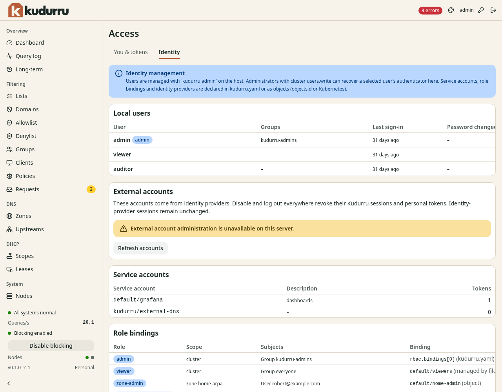

# Manage users, service accounts, roles and sign-in providers

**Before you start**

- You need the `admin` role to inspect and change identity configuration.
- You need a license key for additional roles and single sign-on.
- The changes on this tab need a node with SQLite storage. In a cluster of
  SQLite nodes, use the dashboard of the primary.

## Inspect identity configuration

1. Open **System** > **Access**.
2. Select **Identity**.
3. Read **Local users** for local accounts.
4. Read **External accounts** for accounts from single sign-on.
5. Read **Service accounts** for program accounts and token counts.
6. Read **Role bindings** for subjects, roles and scopes.
7. Read **Identity providers** for configured sign-in providers.

*Figure 1. The Identity tab lists every kind of identity object, with its actions on each row.*

Every change on this tab is one request bound to the exact version of the
object that you reviewed (its UID and resourceVersion). The dashboard never
sends a change twice:

- **Refused**: the object changed, was deleted or belongs to another manager
  since you read it. Close the dialog, let the list reload and decide again.
- **Outcome unknown**: the server could not say whether the change was made.
  Close the dialog and read the list before you act again. The server answers
  the same way when the cluster reached its limit of revocation records (see
  below); then nothing changed.

Objects of `kudurru.yaml` or `objects.d` show their actions disabled with the
reason: change them where they are declared. Change the built-in `admin` with
`kudurru admin` on the host.

## Local users

- **New user** creates an account with a username, an optional display name
  and a first password. The user must change it at the first sign-in. A new
  account has no role: create a role binding with the user, or one of its
  local groups, as the subject.
- **Edit…** changes the display name and the list of local groups. Changing
  the groups signs the account out and deletes its API tokens.
- **Disable…** stops the account from signing in, ends its sessions and
  deletes its API tokens in the same commit. **Enable…** lets it sign in
  again; nothing that was ended comes back.
- **Reset password…** sets a new password that the user must change at the
  next sign-in, signs the account out and revokes its personal tokens. It does
  not remove the authenticator; use **Recover authenticator…**
  ([remove the authenticator of a different person](../admin/09-people-and-tokens.md#remove-the-authenticator-of-a-different-person)).
- **Delete…** deletes the account, its sessions and its tokens. A later
  account with the same name inherits nothing.

## Service accounts

- **New service account** creates an account for a program in a namespace,
  with a description. It has no password and no token yet.
- **Edit…** changes the description or disables the account. Disabling it
  deletes all of its tokens; enabling it again restores none.
- **New token…** issues an API token for the account, with a description, a
  lifetime and an optional role limit. It needs `serviceaccounts.write` and
  `tokens.write`. The token never outlives the API token you are signed in
  with, and stays within `auth.tokens.maxLifetime`.
- **Delete…** deletes the account and all of its tokens.

CAUTION: The dialog shows the new token once. Copy it into the program's
secret store before you click **Done**: kudurru keeps only its hash, and the
dashboard forgets it when the dialog closes.

## Identity providers

**New identity provider** and **Edit…** take the provider ID, the display
name, the issuer URL and the client ID. The CLI client ID, the redirect URL
and the scopes are optional. The form also asks where the client secret is.
Name an environment variable or a file on every node that
`credentials.allowedEnvironment` or `credentials.allowedFiles` allows. You
never type the secret itself.

**Edit…** keeps the fields that
the form does not show (claim mappings and rules, provisioning, allowed
domains, audiences) as they are stored. Changing or deleting a provider ends
every session and token that came from it. A provider of `kudurru.yaml` is
changed in that file.

## Role bindings

A role binding connects a user, group or service account to a role.
A zone scope limits a `zone-admin` binding to one zone.
A zone-group scope covers every zone labeled `kudurru.io/zonegroup: <group>` and its records.
Removing the label from a zone takes the access away at once.
Only an administrator with cluster-wide `zones.write` can move a zone into or out of a group.

1. Click **New role binding** in **Role bindings**.
2. Enter a name and a namespace, and pick the role.
3. Pick the scope: **Everything**, **One zone** or **A zone group**.
4. Pick the zone, or type the group. The form lists the groups your zones use.
5. Pick the subject kind, type its name and click **Create**.

A name that already exists is refused. **Edit…** changes the role, the scope
or the subject of a binding that was created through the API. Change a binding
with more than one subject with `kudurru iam rolebindings replace`.
**Delete…** removes it, and its subjects lose what it granted at once.

People with a zone or zone-group binding see the actions of their zones
enabled on the zone pages, and the actions of other zones disabled.
A sign-in provider alone does not grant access; a matching role binding is also required.

## Limits

Some changes keep a small permanent revocation record for the account or
provider. These changes are a disable, a group change, a password reset, a
provider change and every delete. Together with the
active sessions, these records share a limit of about 4,000 entries per
cluster, and nothing removes them. At the limit, deletes, disables and new
sign-ins answer `503` and change nothing. Prefer disabling a long-lived
account to creating and deleting one per job.

## Where the actions are disabled

- **On an enrolled follower**: every change runs only on the primary. Open the
  dashboard of the primary; the tooltip names it.
- **In static mode**: identity is read-only on the node.
- **On a node with Kubernetes storage**: the server offers none of these
  changes. Manage people in your identity provider, service accounts,
  identity providers and role bindings with `kubectl` or your GitOps tool, and
  the built-in admin with `kudurru admin`. **External accounts** keeps its
  actions.
- **Without the permission**: the tooltip names it, for example
  `users.write`.

## Change access at its source

Use the [role binding procedure](../admin/09-people-and-tokens.md#give-a-role-to-a-person)
for configuration examples and Kubernetes resources.
Use the [single sign-on reference](../admin/09-people-and-tokens.md#single-sign-on)
for provider fields. Changes to file-based `rbac.bindings` need a node restart.
Keep a working administrator session while you validate new access.

## Check the result

Sign in with the affected account in another browser session.
Confirm that the intended pages and actions are available.
Read its roles on **You & tokens** before you remove old access.
