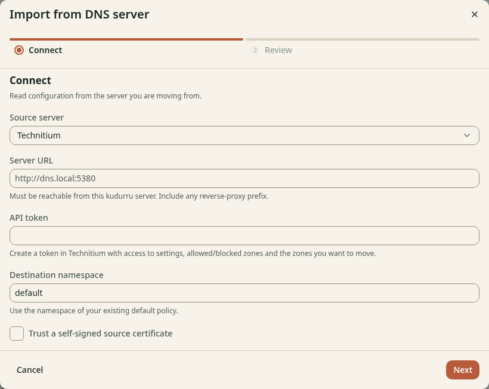

# Import DNS configuration

**Before you start**

- You need the `admin` role and a [backup](../admin/11-maintenance.md#back-up) of your current setup.
- The kudurru node must reach the source DNS server.
- You need a Technitium API token or a Pi-hole v6 application password.

## Preview a migration

1. Open **System** > **Tools**.
2. Click **Import from DNS server**.
3. Select **Technitium** or **Pi-hole v6** in **Source server**.
4. Enter the source **Server URL**.
5. Enter the **API token** or **Application password**.
6. Set **Destination namespace** to the namespace of your existing default policy.
7. Click **Next** to retrieve the preview.

*Figure 1. The kudurru node needs network access to the source server.*

For Pi-hole, **Local DNS suffixes** selects the suffixes that become authoritative.
Missing names under these suffixes stop forwarding upstream.
Use **Trust a self-signed source certificate** only for a source whose certificate you trust.

## Review and import

1. Read the object list and every migration warning on **Review**.
2. Click **Show converted objects** to inspect the configuration.
3. Select **I reviewed the configuration and migration warnings**.
4. Click **Import configuration**.
5. Read the result for failed objects or settings.

Import can apply some changes before another change fails.
Correct reported errors before you switch clients. Keep the source server available during validation.

## Apply kudurru objects

For existing kudurru YAML or JSON, use **Import objects** on **Tools**.
Paste the objects into **Objects**, then click **Apply**.
The API applies whole objects and refuses edits to objects owned by another source.
For a BIND zone file, use **Import zone file** on **Zones**.

## Check the result

Inspect imported lists, groups, policies, zones and upstreams on their pages.
Test allowed, blocked and local names with [Tools](tools.md) and one real client.
Confirm that settings persist before you move the remaining clients.
