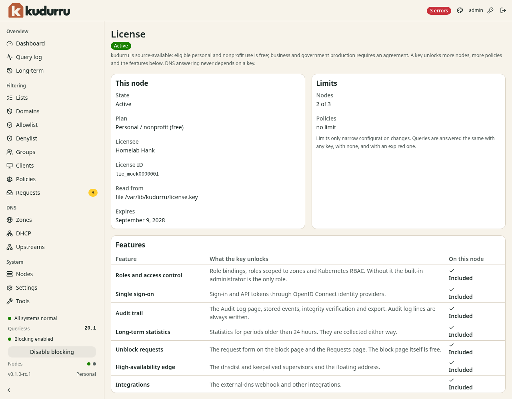

# Check license features and limits

**Before you start**

- You need a signed-in dashboard account.
- You need host or deployment access to install a key.

## Read the current state

1. Open **System** > **License**.
2. Read **State**, **Plan**, **Read from** and **Expires** under **This node**.
3. Compare node usage with the limit under **Limits**.
4. Check the policy limit.
5. Find the feature you need under **Features**.

*Figure 1. Included and Needs a key explain feature availability.*

The page is read-only. Use **Add or change the key** to find the supported
host and deployment settings. For Helm, use `license.existingSecret`.
Follow [Install a key](../admin/13-license.md#put-a-key-on-a-node) for the full procedure.

Without a key, configuration is limited to 1 node and the `default` policy.
Additional roles, access requests, audit access and long-term views need a key.
DNS answers continue with no key or an expired key.
Use the [licensing terms](../../../LICENSING.md) to check which agreement applies to your use.

## Check the result

After installing a key, wait up to 1 minute and reload **License**.
Confirm the intended plan, limits and feature status.
If the key appears on the wrong node only, check the configuration of every replica.
