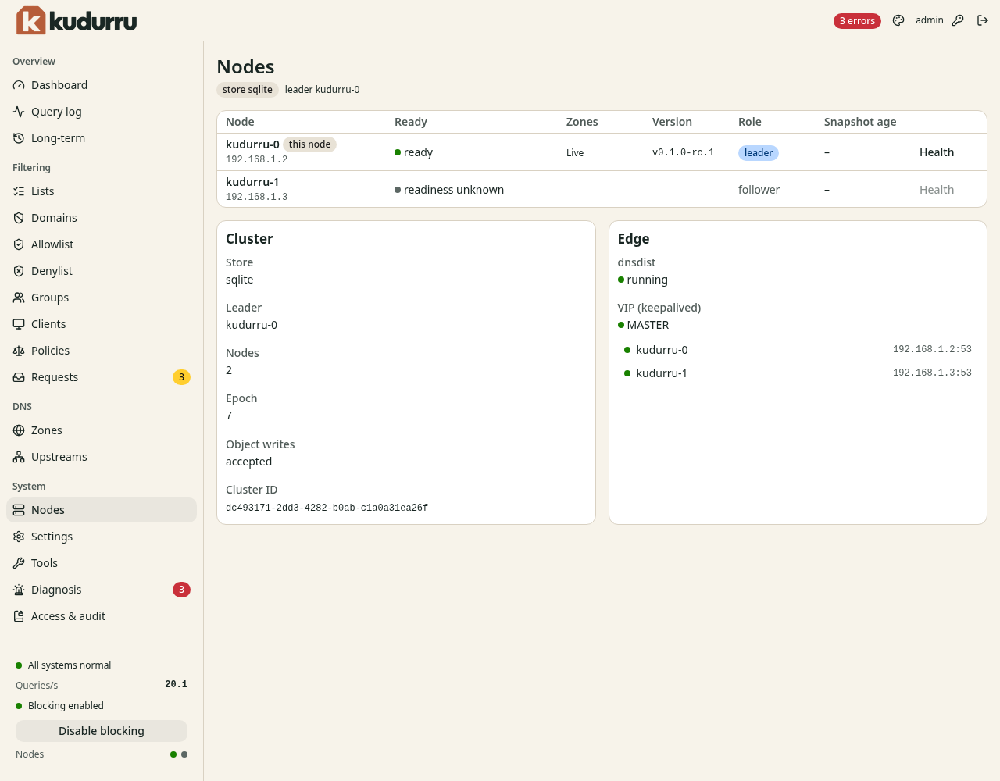

# Check node and cluster health

**Before you start**

- You need the `admin` role.
- You need to know which nodes belong to this deployment.

## Inspect the deployment

1. Open **System** > **Nodes**.
2. Check **Ready** for each node.
3. Compare **Version** across the nodes.
4. Check **Zones** and **Snapshot age** for stale configuration.
5. Click **Health** for a node that needs investigation.

*Figure 1. The page distinguishes the node serving your dashboard from the cluster leader.*

The leader handles jobs that run once, such as list refreshes.
Another node takes over if the leader stops.
This leader is separate from the DHCP serving replica.

**Cluster** identifies the store, leader, epoch and object write availability.
**Edge** reports dnsdist, the floating address and backends when configured.
Use [Diagnosis](diagnosis.md) for linked configuration problems and [Tools](tools.md) for API health checks.

## Run an enrolled SQLite cluster

On a SQLite node, **Cluster membership** shows this node's enrollment: its
mode (`standalone`, `primary` or `follower`), the cluster ID and the member
ID. The button next to the title depends on the mode. Each wizard reads the
current state when it opens. It sends exactly what you confirmed. If you read
the state again or clear "I reviewed", confirm again before you finish.

The wizard sends its command one time. You cannot close the dialog until the
command answers. In three cases the wizard sends nothing more. The reviewed
state changed (`409`), the answer is lost, or the answer says that the
outcome is unknown. Then close the dialog, check the enrollment and decide
again. The commands need the `admin` role.

- **Activate cluster** (a dormant standalone node): review the enrollment.
  Give the member name, the internal address and a reason, then activate.
  The internal address is the `host:port` of the internal listener (port 8082
  by default). Then restart kudurru on that node. Until then, followers
  cannot join.
- **Invite a member** (the primary): review the enrollment. Give the new
  member's name, its internal address, the validity of the invitation and a
  reason, then issue it. The validity is 2, 5 or 9 minutes on your
  computer's clock. The primary accepts at most ten minutes on its own clock.
  A `409` refusal has one of three causes. The primary's state changed. An
  earlier member uses or reserves the name or the address. Or the expiry is
  too far ahead or already past on the primary's clock. Then start a new
  wizard. The next screen shows the
  invitation once, with the `kudurru cluster join --offline` command and the
  Docker Compose changes for the new node. Copy the invitation over a private
  channel; closing the dialog drops it and it is not shown again. If the join
  fails, follow
  [Recover an incomplete join](../../deploy/sqlite-join.md#recover-an-incomplete-join)
  instead of issuing a second invitation.
- **Review promotion** (a follower): the wizard shows whether the follower
  is eligible (its primary unreachable for two pull intervals) and why not.
  Type the node's name and a reason to promote it. Promote one follower only.

**Root trust anchors** shows the managed root trust-anchor state of this
node (`kudurru cluster anchors`). It shows the owner and its keys, the updater
and the root check, and the last pull from the primary. It also shows every
state that needs you, with a link to what to do. That includes a member that
refuses the trust-anchor state of the primary and a member fenced behind its
term. Every member shows its own state, so open the dashboard of each member.

A fenced or conflicted member closes its API. Its dashboard shows only that
it is fenced or in conflict, with a link to the procedure. Read its
`kudurru_root_anchor_*` metrics, or stop it and run
`kudurru anchors status --offline`.

[Enrolled SQLite cluster](../../deploy/sqlite-cluster.md) describes every step
with the CLI.

## Query-log sinks

**Query-log sinks** lists the destinations of `querylog.sinks` that this node runs.
It needs the `querylog.read` permission.
Each row shows the sink type and its queue: the waiting queries and the bound.
It also shows the accepted and dropped queries and the failed attempts.
**Last success** is the time of the last successful write.
**raw** marks a dnstap sink that receives queries before the privacy transform.
Every node runs its own sinks, so open the dashboard of each node.

The panel never shows the address or credentials of a sink, and no error text.
The node's log and the `kudurru_sink_errors_total` metric name the reason of a failure.
See [Query-log sinks](../../deploy/query-log-sinks.md).

## Check the result

All expected nodes are ready and use the intended version.
If a node is unavailable, treat combined statistics as partial until it recovers.
Use the [operations runbooks](../../deploy/runbooks.md) to investigate deployment failures.
