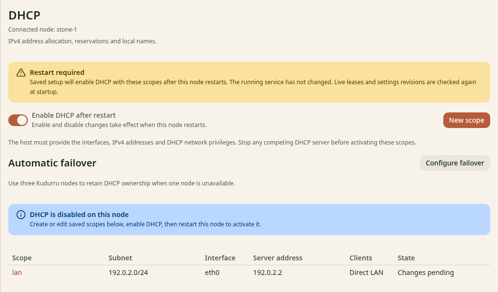
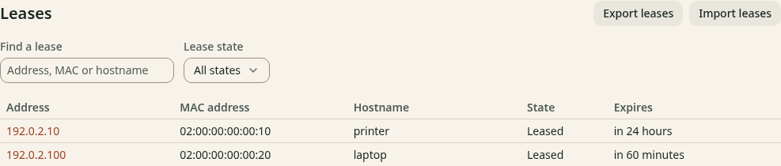

# Activate and check DHCP

**Before you start**

- You need the `admin` role and permission to restart the Linux node.
- You need a saved scope and the required [host privileges](prepare.md).
- You need a copy of the old DHCP configuration and its final lease data.

CAUTION: Existing leases stay valid until they expire. Prevent kudurru from
reusing addresses that the old server assigned to other clients.

## 1. Prepare the cutover

1. Save the old server's options and reservations.
2. Open **DNS** > **DHCP** in kudurru.
3. Turn on **Enable DHCP after restart**.

*Figure 1. The saved enabled state does not change the running service.*

The notice **Restart required** means that the current allocator has not changed.
The scope can show **Changes pending** or **Saved, not running**.

## 2. Switch the service

1. Stop the old DHCP service.
2. Export its final leases if your migration uses an import.
3. Prevent client DHCP traffic from reaching kudurru until the import completes.
4. Restart the kudurru node.

   For Docker, use `docker restart kudurru`.
   For systemd, use `sudo systemctl restart kudurru`.

5. Import the final leases from the scope page, if needed.
6. Allow client DHCP traffic to reach kudurru.

Use a nonoverlapping pool or wait for old leases to expire if you cannot import them.
The [import guide](../../deploy/dhcp-leases.md#lease-import-and-export)
lists supported formats. Do not start two independent allocators on the same pool.

## 3. Test one client

1. Open **DNS** > **DHCP**.
2. Confirm that the scope says **Running**.
3. Renew the DHCP lease on one test client.
4. Open the scope and find the client in **Leases**.
5. Check the client's address, subnet mask, gateway and DNS server.
6. Run `nslookup example.com` on the client.

*Figure 2. A bound client appears as Leased.*

To renew, use the network settings of the test client:

| Client | Action |
|---|---|
| Windows | Run `ipconfig /renew` in a terminal |
| macOS | Open the network details, select **TCP/IP**, then click **Renew DHCP Lease** |
| Linux desktop | Use automatic IPv4 (DHCP), then disconnect and reconnect the network |

The address comes from your pool or a reservation. The DNS server matches
your node. If registration is on, query the client's full local name too.

## Check the result

Restart kudurru and renew the test client's lease again. Confirm that its
address and DNS still work. Test a second client before you move the rest.

If startup fails, use [DHCP diagnosis](../../deploy/dhcp-management.md#repair-a-setup-that-could-not-start).
If no lease appears, check UDP ports 67 and 68, the interface and any relay settings.

For rollback, stop kudurru DHCP before you restore the old service.
On SQLite, turning off the switch also needs a restart.
Account for every unexpired kudurru lease in the old server's pool before you restart it.
