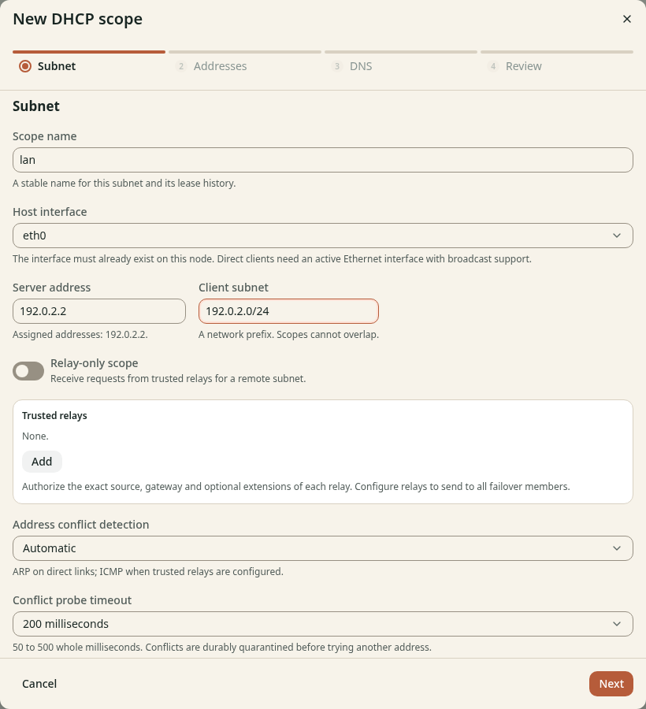

# Create a DHCP scope

**Before you start**

- You need the `admin` role on the node that assigns addresses.
- You need the values from [Prepare your network](prepare.md).
- You need a fresh scope setup that the dashboard can manage.

This page is for direct clients on a Linux node with SQLite.
For Kubernetes, use [Create a scope with a trusted relay](kubernetes/create-scope.md).

If the page says **Managed by the configuration file**, follow
[Adopt existing setup](../../deploy/dhcp-management.md#dashboard-and-api-ownership) first.

## Describe the subnet

1. Open **DHCP** > **Scopes** on the node that assigns addresses.
2. Click **New scope**.
3. Enter `lan` in **Scope name**.
4. Select your **Host interface**.
5. Enter its fixed IPv4 address in **Server address**.
6. Enter the network prefix in **Client subnet**.
7. Keep **Relay-only scope** off for clients on this local network.
8. Keep **Address conflict detection** set to **Automatic**.

*Figure 1. Select an existing host interface and address.*

Leave **Trusted relays** and **Failover server addresses** empty for this single-node walkthrough.

## Check the result

The **Subnet** step shows your planned interface, server address and network.
Keep the wizard open and continue to [Set the address pool](address-pool.md).
