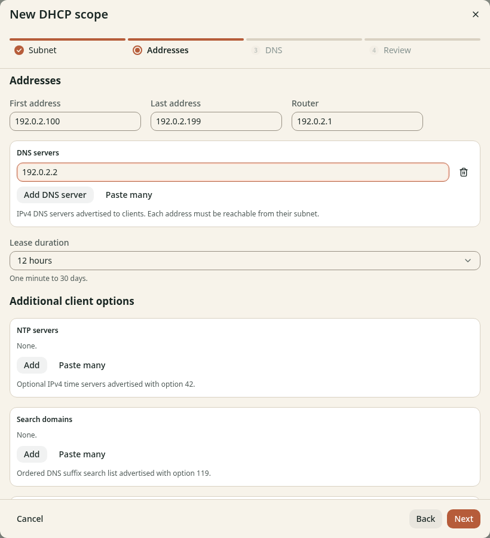

# Set the Kubernetes scope address pool

**Before you start**

- You need the open **New DHCP scope** wizard with a [trusted relay](create-scope.md).
- You need your pool, gateway and DNS listener addresses.

## Set client options

1. Click **Next** to open **Addresses**.
2. Enter `192.0.2.100` in **First address**, or use your planned start.
3. Enter `192.0.2.199` in **Last address**, or use your planned end.
4. Enter the client gateway in **Router**, `192.0.2.1` in this example.
5. Click **Add DNS server**.
6. Enter your DNS listener address in **DNS servers 1**, `192.0.2.2` in this example.
7. Keep **Lease duration** at `12h` for this example.

*Figure 1. These values describe the client network, not the pod network.*

The DHCP LoadBalancer address is not automatically a DNS server.
Clients need the address of your DNS Service or DNS edge listener.
Keep additional network and boot options at their defaults unless your network needs them.

## Check the result

The pool fits the client subnet and excludes static addresses and unexpired old leases.
The gateway and DNS listener are reachable from the client VLAN.
Keep the wizard open and continue to [Set lease DNS](lease-dns.md).
