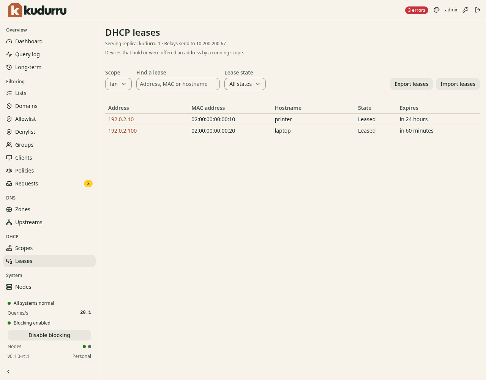

# Switch to kudurru and test a lease

**Before you start**

- You need a ready scope, a prepared relay and a maintenance window.
- You need the final old lease data and a plan for every unexpired address.
- You need access to one test client on the selected VLAN.

CAUTION: Do not run independent DHCP allocators on the same address pool.
Stop the old server before you let the relay forward client traffic to kudurru.

## Switch one VLAN

1. Save the old server's options and reservations.
2. Stop the old DHCP service for this VLAN.
3. Export its final leases if your migration uses an import.
4. Import the final leases in **DHCP** > **Leases**, if needed.
5. Enable the prepared router relay to the DHCP LoadBalancer.
6. Allow the relay traffic through any temporary cutover rules.

Keep client traffic blocked until the import completes.
Use a nonoverlapping pool or wait for old leases to expire if you cannot import them.
The [lease import reference](../../../deploy/dhcp-leases.md#lease-import-and-export) lists supported formats.

## Test a client

1. Renew the DHCP lease on one test client.
2. Open **DHCP** > **Leases**.
3. Choose the scope and find the client.
4. Check the client's address, subnet mask, gateway and DNS server.
5. Run `nslookup example.com` on the client.
6. Query its local name if lease DNS is enabled.



*Figure 1. A bound client appears as Leased.*

| Client | Renew the lease |
|---|---|
| Windows | Run `ipconfig /renew` |
| macOS | Open network details, select **TCP/IP**, then click **Renew DHCP Lease** |
| Linux desktop | Use automatic IPv4 (DHCP), then disconnect and reconnect the network |

You can also read leases from Kubernetes:

```sh
kubectl get dhcpleases -n kudurru-system
```

Use the namespace of your kudurru release. Scopes are cluster-scoped;
leases live in the release namespace.

## Check the result

Renew the lease again. Confirm that the address and DNS still work.
Test a second client before you repeat the procedure for another VLAN.
Use [relay packet checks](../../../deploy/dhcp-kubernetes.md#check-relay-packets) if no lease appears.

For rollback, stop relay traffic to kudurru before you restore the old DHCP service.
Account for every unexpired kudurru lease in the old pool before you restart it.
