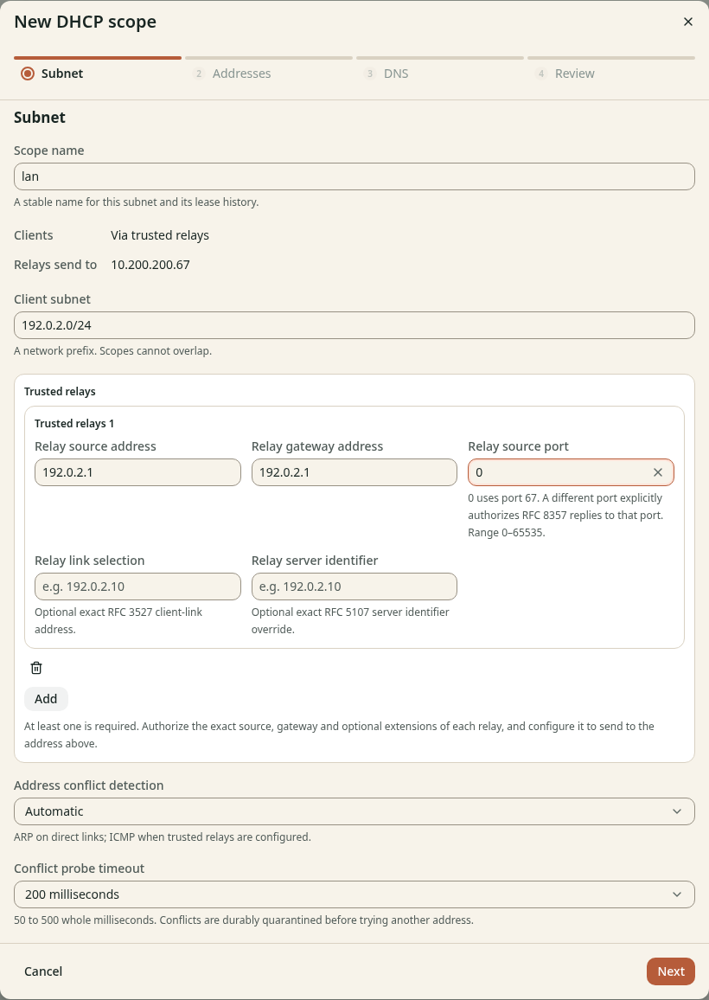

# Create a scope with a trusted relay

**Before you start**

- You need the `admin` role and the [recorded relay values](relay.md).
- You need DHCP enabled through Helm.
- Keep client DHCP traffic away from kudurru until the cutover.

## Describe the subnet

1. Open **DNS** > **DHCP**.
2. Click **New scope**.
3. Enter `lan` in **Scope name**.
4. Confirm that **Relays send to** shows your DHCP LoadBalancer address.
5. Enter `192.0.2.0/24` in **Client subnet**, or use your planned subnet.
6. Click **Add** under **Trusted relays**.
7. Enter the recorded source in **Relay source address**.
8. Enter the recorded `giaddr` in **Relay gateway address**.
9. Enter `0` in **Relay source port** for the normal UDP port `67`.
10. Keep **Address conflict detection** set to **Automatic**.

*Figure 1. Kubernetes requires at least 1 exact trusted relay entry.*

Leave the optional relay extensions empty unless the router sends them.
Use the exact values from the router if it uses link selection or a server identifier override.

Each scope describes one client subnet. Repeat this walkthrough for other VLANs,
with their own gateway and trusted relay entries.

## Check the result

The source matches the router's forwarded packet address. The gateway matches
the client VLAN's `giaddr`. Neither field contains the LoadBalancer address.
Keep the wizard open and continue to [Set the address pool](address-pool.md).
