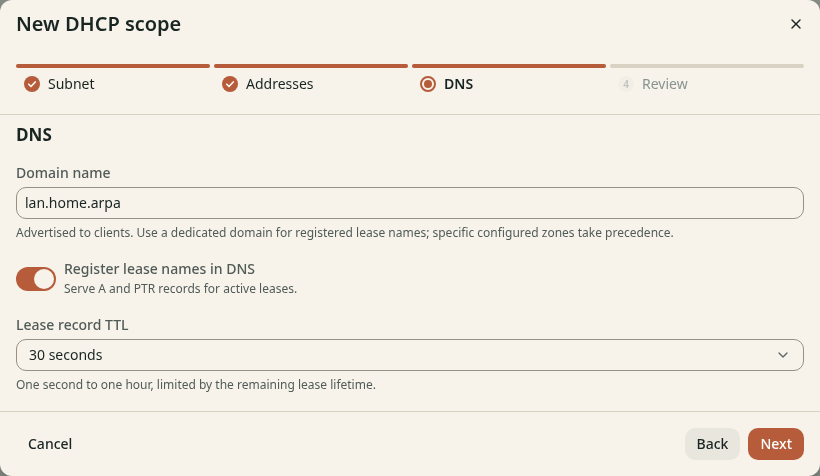

# Set DNS for Kubernetes DHCP clients

**Before you start**

- You need the open wizard after the [Addresses step](address-pool.md).
- You need a dedicated local domain for client names.

## Set the local domain

1. Click **Next** to open **DNS**.
2. Enter `lan.home.arpa` in **Domain name**, or use your planned domain.
3. Turn on **Register lease names in DNS** to publish A and PTR records.
4. Keep **Lease record TTL** at `30s` for this example.

*Figure 1. Active leases can publish local DNS names.*

A more specific configured zone takes precedence over automatic lease names.
See [Lease DNS](../../../deploy/dhcp-dns.md) for the rules.
A reservation alone does not publish a name before the client has a lease.

## Check the result

The domain matches your plan. Clients with a hostname can get names such as
`laptop.lan.home.arpa` after they acquire a lease.
Keep the wizard open and continue to [Review and save](review.md).
