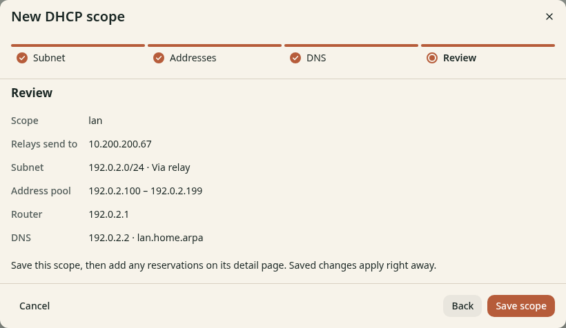
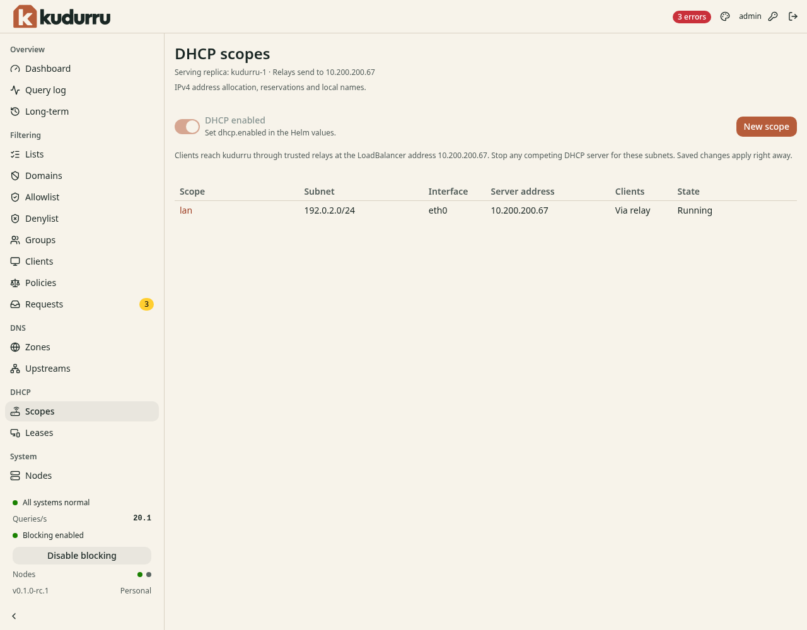

# Review and save the Kubernetes scope

**Before you start**

- You need the open wizard after the [DNS step](lease-dns.md).
- Keep the router relay disabled or block its traffic until the cutover.

CAUTION: Kubernetes scope changes apply live. Saving a valid scope can start
DHCP immediately when the release has DHCP enabled.

## Save the scope

1. Click **Next** to open **Review**.
2. Check the subnet, pool, gateway, DNS server and domain.
3. Confirm that the summary lists the required trusted relay.
4. Click **Save scope**.
5. Open **DHCP** > **Scopes**.



*Figure 1. Check the trusted relay before the scope applies live.*

The **DHCP enabled** switch is read-only. Helm controls this setting.
Kubernetes elects 1 serving replica; scope edits do not need a node restart.



*Figure 2. Helm enables DHCP and Kubernetes selects the serving replica.*

## Check the result

The scope appears on the DHCP page. Check its Kubernetes status:

```sh
kubectl get dhcpscopes
```

`READY` becomes `True`, and `SERVING` names the replica that handles DHCP.
Fix an unready scope before you forward client traffic.
Continue to [Switch and test](check.md).
