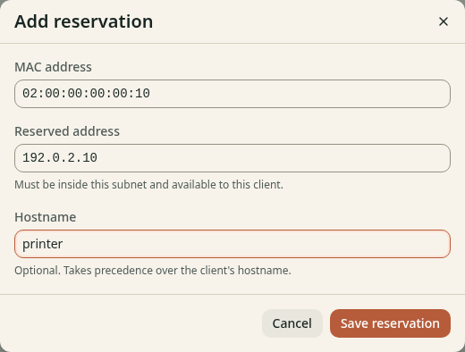

# Reserve an address for a device

**Before you start**

- You need the `admin` role and a running scope managed by the dashboard.
- You need the device's MAC address and an available address inside the subnet.

Use a reservation for a printer, server or other device that needs a stable address.
The reserved address can be outside the dynamic pool, but it must be inside the subnet.

## 1. Add the reservation

1. Open **DNS** > **DHCP**.
2. Open the running scope.
3. Find **Reservations**.
4. Click **Add reservation**.
5. Enter the device's **MAC address**.
6. Enter the **Reserved address**.
7. Enter a **Hostname**, such as `printer`, if you want a local name.
8. Click **Save reservation**.

*Figure 1. Match the reservation to the device's actual MAC address.*

A device with a private or randomized MAC can appear as a different client.
Use the stable MAC for this network.
An address that another client still leases cannot become this device's reservation.

## 2. Renew and verify

1. Renew the device's lease or reconnect it to the network.
2. Find it in **Leases**.
3. Confirm that its address matches **Reserved address**.
4. Query `printer.lan.home.arpa` if lease DNS registration is on.

A reservation on a running API-managed scope applies immediately. The client
receives it when it next acquires or renews a lease.
On SQLite, add reservations under **Setup for next restart** if the scope is not running.
On Kubernetes, scope changes apply live. Edit a managed scope at its configuration source.

## Check the result

The client has the reserved address. Its local name resolves while its
lease is active and DNS registration is on.
A reservation alone does not create a record for an offline device.
For a permanent record, [create a local DNS name](../local-dns/create-name.md).
