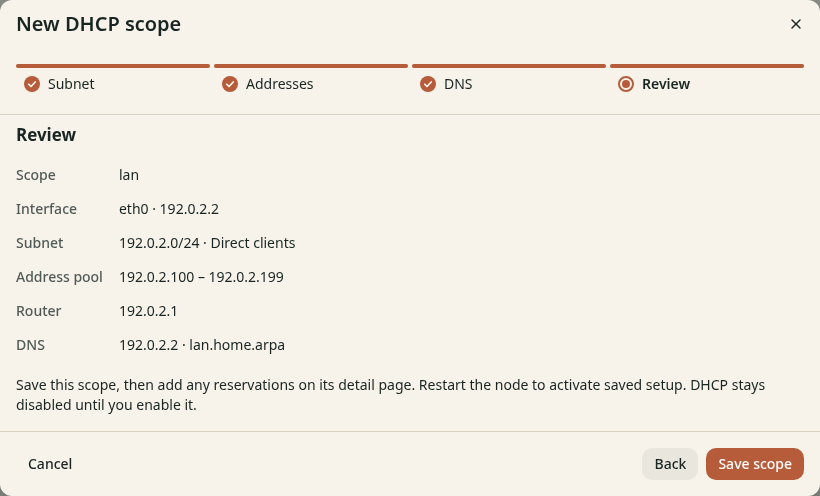

# Review and save the DHCP scope

**Before you start**

- You need the `admin` role and the open **New DHCP scope** wizard.
- You need to complete the [DNS step](lease-dns.md).

## Review and save

1. Click **Next** to open **Review**.
2. Check the interface, subnet, pool, router and DNS addresses.
3. Click **Save scope**.

*Figure 1. Check every address before you save.*

## Check the result

The scope detail page opens. **Setup for next restart** shows the saved values.
DHCP stays disabled until you enable it and restart the node.
Continue with [Activate and check DHCP](activate.md).
