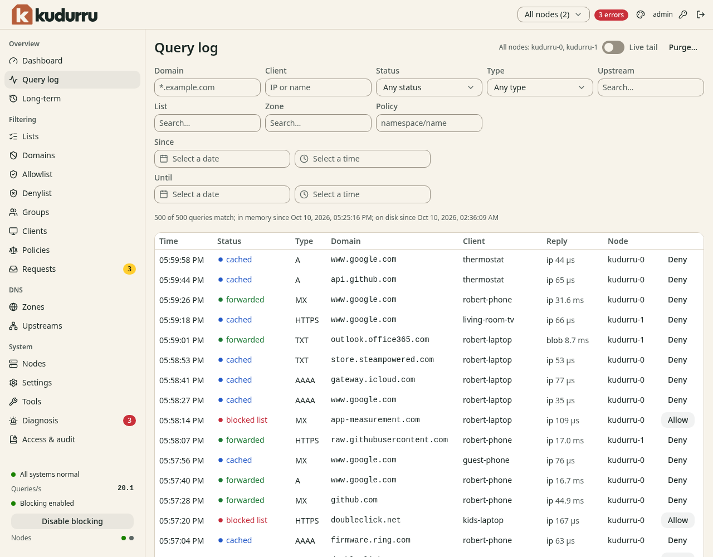
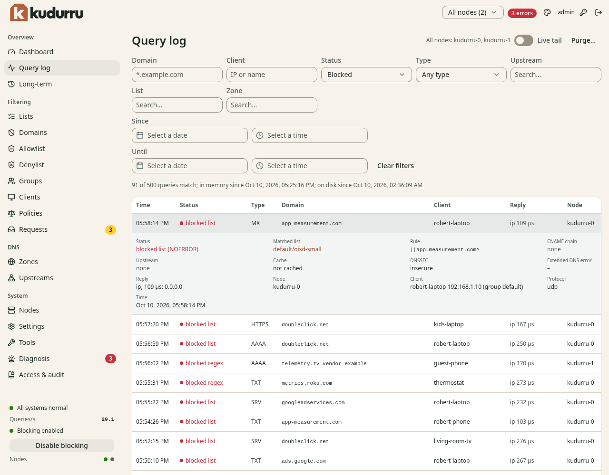

# Read your first queries

**Before you start**

- You need a role with access to **Query log**, such as `admin` or `viewer`.
- You need a client that uses kudurru for DNS.

## 1. Find your client

1. Open **Query log**.
2. Enter the client address in the **Client** filter.
3. Run `nslookup example.com` on that client.
4. Find `example.com` in the table.

*Figure 1. Filter the log to find your test query.*

If your router forwards DNS, the log can show the router address instead
of each client. Give clients the node address directly to see them separately.

## 2. Explain an answer

1. Click the query row to open its details.
2. Read the status and the answer.
3. Read the upstream, zone or matched list that explains the result.

*Figure 2. The details explain why kudurru answered.*

| Result | Meaning |
|---|---|
| Forwarded | An upstream DNS server answered |
| Cached | kudurru reused an answer |
| Authoritative | A local zone answered |
| Blocked | A list or policy refused the name |

## Check the result

You can find a query from your client and explain its result.
Next, [add a block list](../filtering/add-list.md),
[allow a blocked site](../filtering/allow-site.md), or
[create a local name](../local-dns/create-name.md).

For charts, time ranges and node selection, see
[Watch the network](../admin/03-watch-the-network.md).
