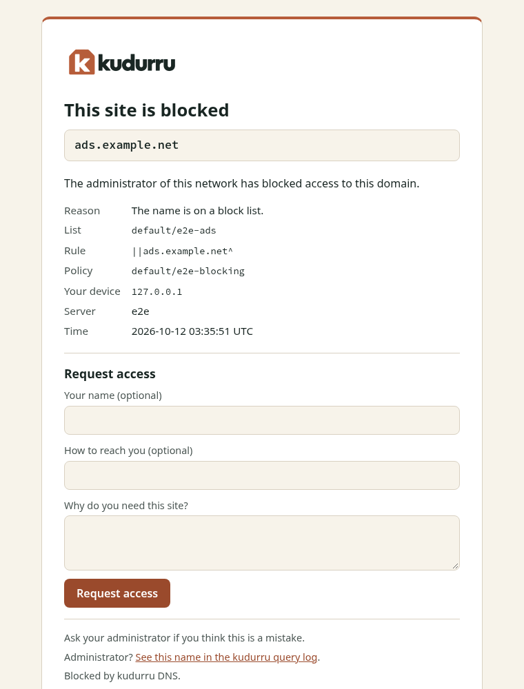
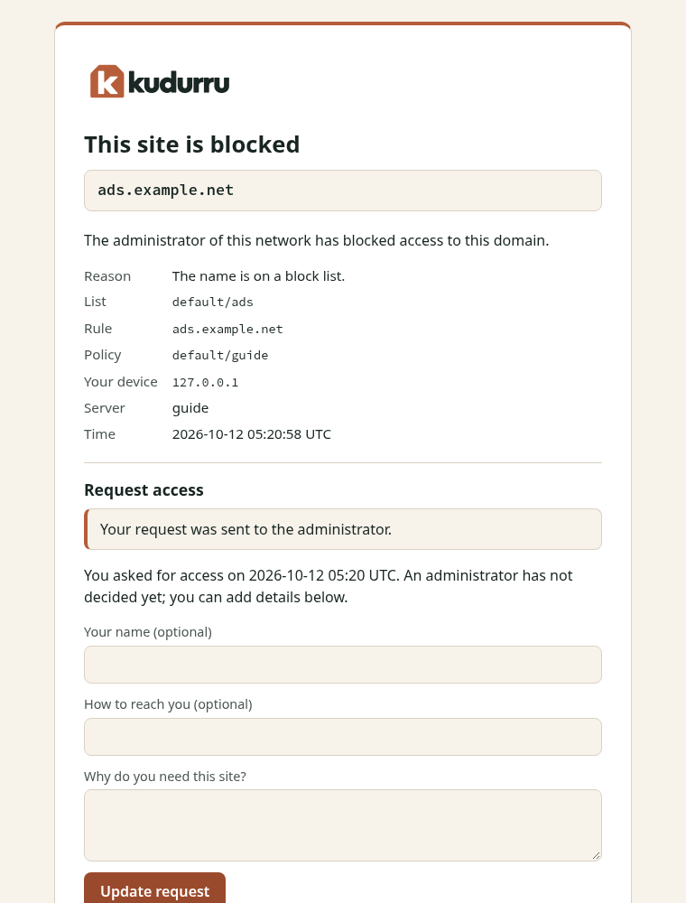
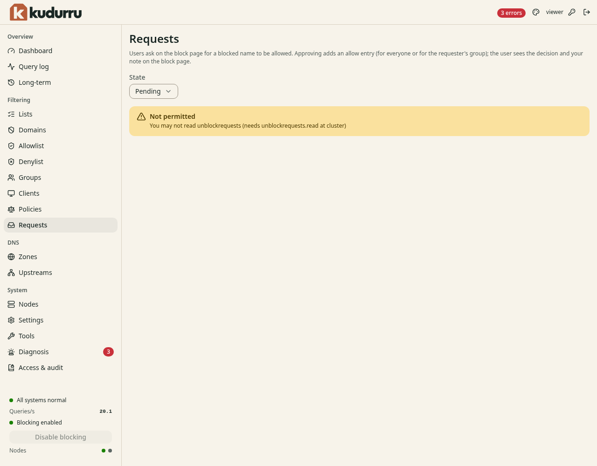

# User guide

This guide is for people who use a network that kudurru serves. You do not
install or set up anything. You see kudurru in two cases:

- A site is blocked, and a page tells you so.
- An administrator gives you an account for the dashboard.

## What kudurru does for you

kudurru is the DNS server of your network. Your device asks kudurru for the
address of a site. kudurru gives the address, or it refuses.

The administrator of your network decides which sites kudurru refuses.
Typical reasons are advertisements, trackers, unsafe sites and sites that
are not for children.

## A site is blocked

When you open a blocked site, your browser can show the kudurru block page.
Figure 1 shows an example.

*Figure 1. The block page.*

NOTE: The form **Request access** needs a license key on the server. If the
page has no form, ask the administrator.

The page shows this information:

| Item | Meaning |
|---|---|
| **This site is blocked** | The title. The administrator can change it. |
| The name in the gray box | The name that kudurru blocked. |
| The message | Text from the administrator of your network. |
| **Reason** | Why kudurru blocked the name. |
| **List** and **Rule** | The block list and the rule that matched the name. |
| **Policy** | The policy that applies to your device. |
| **Your device** | The address of your device. |
| **Server** and **Time** | The kudurru node that answered and the time. |

NOTE: The administrator can hide the reason, the list, the rule and the
policy. Then the page shows only the name and the message.

## Ask for access

You can ask the administrator to allow a blocked name. The page has a form
for this.

**Before you start:** Make sure that the name in the gray box is the site
that you need.

1. Open the blocked site in your browser. The block page shows.
2. Enter your name in **Your name (optional)**.
3. Enter an email address or a telephone number in **How to reach you
   (optional)**.
4. Enter a short reason in **Why do you need this site?**. Use 500
   characters at most.
5. Click **Request access**.

The page shows **Your request was sent to the administrator.** (Figure 2).

*Figure 2. The block page after you send a request.*

The name, the contact and the reason are optional. The administrator sees
them. The administrator also sees the address of your device, or only the
network of your device. This depends on the privacy settings of the
network.

If you send the form again for the same name, kudurru updates your first
request. It does not make a second request. Each device can send 5 requests
in 1 hour. The administrator can change this limit.

## After you ask

The block page shows the state of your request every time that you open
the name again.

| State | What the page shows | What you do |
|---|---|---|
| Pending | The time of your request. The form stays on the page. | Wait. You can add details. |
| Approved | A message that tells you to try again in a moment. | Open the site again. |
| Denied | The note of the administrator and the form. | Read the note. Ask again if you have a new reason. |
| Ended | The form. | Ask again. The approval ran out, or nobody decided in time. |

After an approval, your device can keep the old answer for a short time.
The default time is 10 minutes. If the site still shows the block page, wait
and try again. You can also close the browser and open it again.

## If the block page does not show

kudurru cannot always show the block page. These are the usual causes.

- **The browser shows a certificate warning.** The site uses HTTPS. The block
  page cannot show a valid certificate for a site that it does not own.
  Do not install a certificate to remove the warning. Ask the
  administrator.
- **The browser shows an error and no warning.** Some sites tell the browser
  to use HTTPS only. The browser then refuses the block page. This is
  normal. Ask the administrator if you need the site.
- **An app shows its own error.** An app does not show web pages. It shows
  that it cannot connect. Ask the administrator if you need the app.
- **The site is not blocked on your device.** Some browsers use their own
  secure DNS service. kudurru does not see these queries. Ask the
  administrator which setting to use.

## Use the dashboard

An administrator can give you a dashboard account with the role Viewer. The
dashboard shows the state of the network. A viewer cannot change it.

### Sign in

1. Open the address that the administrator gave you, for example
   `https://dns.example.net:8080/`.
2. Enter your user name and your password.
3. Click **Sign in**.

If the page has a button for single sign-on, click it. Then sign in with
the account of your company.

NOTE: The browser can show a certificate warning at the first visit.
Ask the administrator if the warning is normal.

### Change your password

A local account can change its own password.

1. Click the key icon at the top right of the page.
2. Enter your **Current password**.
3. Enter a **New password** of 8 characters or more.
4. Enter the new password again in **Confirm password**.
5. Click **Change password**.

The dashboard signs out every other session of your account.

### What you can see

The navigation list at the left of the page has all the pages. Your role
decides which pages work for you. A viewer can read these pages:

- **Dashboard**: the number of queries, the blocked queries and the charts
- **Long-term**: the same statistics for 7 days to 1 year (this page needs a license key; ask the administrator)
- **Lists**, **Domains**, **Allowlist** and **Denylist**: what kudurru blocks and allows
- **Groups**, **Clients** and **Policies**: who gets which rules
- **Zones**, **Upstreams** and **Settings**: how the network is set up

A page that your role cannot read shows a **Not permitted** message
(Figure 3). A button that your role cannot use is gray.

*Figure 3. A page that the role Viewer cannot read.*

The role Viewer cannot read the **Query log**, the **Requests** page and the
audit log. These pages show what each client asks for. The roles Auditor and
Operator can read the first two. Only the Auditor and the Administrator can
read the audit log. Only the Administrator can read the **Nodes** page. The [administrator guide](admin/09-people-and-tokens.md#roles)
lists all the roles.

### Change the appearance

The appearance is only for your browser. The administrator does not see it.

1. Open the **Settings** page.
2. In **Appearance**, select **Auto**, **Light** or **Dark**.
3. Select a **Theme**.
4. Turn on **High contrast** if you need stronger colors.

### Sign out

Click the sign-out icon at the top right of the page. The dashboard also
signs you out after 30 minutes without activity. A sign-in lasts 12 hours
at the most. An administrator can change these times.

## Privacy

The query log of kudurru records the names that devices ask for. The
administrator decides what the log keeps. It can keep the full address of
your device, only the network of your device, or nothing.

Ask your administrator what your network records and for how long.

## Get help

Ask the administrator of your network. Give them this information:

- the name that is blocked, from the gray box on the block page
- the time that the block page shows
- the address of your device, from **Your device**
