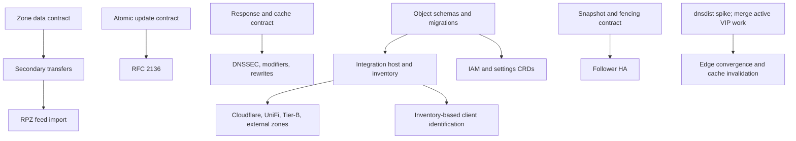

# v0.2.0: clay copies

Planning review, 2026-10-14, against `7064012` on `main`. This is a proposed
implementation sequence for the existing requirements, not a claim that the
features are implemented or that the release scope has been reduced.

The product scope is in [architecture §13.2](../architecture.md#132-v02--clay-copies-12-weeks).
Detailed contracts are spread across architecture §§4–11, the decision log,
and [follow-ups](../followups.md). The [architecture tour](../architecture/README.md)
is a better starting point for current behavior than the original design
record, although both need reconciliation with recent code.

## Starting point

The v0.1 implementation is a suitable base for beginning v0.2 development.
It already has the resolver transports, primary and forward zones, outbound
transfers and NOTIFY, blocking, the two production store drivers, auth, the
dashboard, and multi-node query-log and statistics reads.

GitHub lists [v0.1.0-rc.4](https://github.com/robertherbaugh/kudurru/releases/tag/v0.1.0-rc.4)
as a published pre-release at the time of this review; `VERSION` is still
`0.1.0`. Statements that no candidate has been tagged are historical. This
review does not certify the v0.1 GA gates: the [release checklist](../release-checklist.md)
still calls for release validation, including real dnsdist transport checks
and two-VM keepalived failover evidence.

Work already in progress is separate from this plan:

- [PR #50](https://github.com/robertherbaugh/kudurru/pull/50) changes the
  supervisor charts, VIP CLI, and keepalived rendering for multiple DMZ VIPs.
  Rebase the v0.2 edge work after it lands.
- [PR #49](https://github.com/robertherbaugh/kudurru/pull/49) addresses license
  portal email delivery. It does not block the DNS feature packages.

Develop v0.2 on feature branches while v0.1 finishes. The current release
workflow promotes whole branches (`main` → `release-candidate` → `release`),
so keep v0.2 feature commits out of the v0.1 candidate promotion. This review
does not bump versions or change the release workflow.

## Implementation progress

The recommended first secondary slice is implemented in `internal/secondary`,
with raw immutable zone data, TCP/TLS AXFR and IXFR with TSIG, independent
per-node SOA timers,
durable last-good copies, expiry coverage, inbound NOTIFY with authenticated
peer fan-out, and API/CLI/dashboard diagnostics.
See [the current architecture](../architecture/zones.md#secondary-copies) and
[operator guide](../guide/admin/07-zones-and-upstreams.md#create-a-secondary-zone).
The regression suites cover serial wrap, failed/corrupt transfers, restart,
configuration identity changes, bounded scheduling, CNAME zone boundaries,
real BIND transfers and the browser create/edit/expiry workflow.

The full 11-package release is being implemented in a single
[draft PR #54](https://github.com/robertherbaugh/kudurru/pull/54), with small
commits and periodic rebases on main, currently `e6df232` including the merged
supervisor/VIP work. AXFR/IXFR, verified TLS, inbound NOTIFY
and stub discovery/routing are implemented with API/CLI/dashboard diagnostics.
Stub acceptance covers native BIND UDP/TCP discovery, restart, expiry and the
browser create/edit flow. Signed-secondary response assembly supports NSEC/NSEC3 and opt-out, with
native BIND listener acceptance and durable manager acquire/restart coverage.

Local DNSSEC validation, explicit trust/negative-trust anchors, raw cache
provenance and isolation, and final AD/CD/DO handling are implemented. Real
BIND NSEC/NSEC3 listener and cache tests cover positive, alias, wildcard,
negative and tampered data. Response processing adds configured policy
rewrites, DNS64, AAAA filtering, NXDOMAIN handling and rebinding protection,
with nullable client-policy overrides, live settings, CLI metadata and dashboard
editors. Native UDP/TCP and browser acceptance pass; see the
[response-processing guide](../deploy/response-processing.md). The modifier
compiler and real edge packet-cache isolation acceptance remain in progress.

The HA foundation includes complete versioned replication images, atomic
replacement, persisted authority fencing, local follower reads, authenticated
transport, command transactions and promotion coordination. Complete-bundle
publication and DNS request capture are implemented, including inherited
alias/DNS64 views, detached-cache fencing and transfer cleanup across all six
listeners. Authentication now has a complete-image owner and a leased HTTP
adapter; strict list preparation requires exact published body digests.
The real complete-owner builder has restart, follower install, promotion and
held DNS/HTTP lease acceptance. SQLite production DNS/HTTP mounting now uses the
complete runtime. Peer transition exclusion, remaining public adapters and
multi-node partition/rejoin acceptance remain open; this is not consensus.

RFC 2136 parsing/planning, prerequisite and ownership checks, bounded private
zone aggregates, SQLite transactions and Kubernetes immutable-chunk/head CAS
are implemented. Source reconciliation, committed-primary materialization,
parent fences and retirement now have a transactional SQLite lifecycle adapter.
Complete-image primary preparation validates persisted heads, chunks and parent
witnesses without compiling desired primary records. Native TSIG proofs retain
their original deadline through final transaction admission. A bounded durable
lifecycle driver and exact complete-bundle publication acknowledgment are tested
together with real current keyring/policy exclusion. Native UPDATE and a bounded
durable NOTIFY sender now have signed transport and actual SQLite acceptance,
including ancestor expiry and recovery after a committed but unpublished update.
The root command pin now retains provider, host/license/auth-key, TSIG, catalog
and manager exclusion through final admission, with mandatory original-cut and
deadline checks. Committed primary status uses exact head/configuration evidence
and protected publication, preserves dynamic UPDATE data, and avoids competing
serial writes and status-RV feedback. Native UPDATE/status and real SQLite
transaction acceptance pass. Primary serving now requires the committed head's
configuration and source receipt to match the current DNSZone; advancing only
the lifecycle source cannot expose old configuration. Pending DNSRecordSet-only
edits retain the last committed records until reconciliation.
Captured primary routing, admission and publication diagnostics also agree at
the earliest ancestor expiry, including after durable restore and parent refresh.
The root runtime assembly is mounted on SQLite DNS listeners; Kubernetes
barriers and authenticated forwarding remain in progress.
The combined root assembly now runs provider acquisition/publication on every
role and resets provider floors under the original elected writer before primary
work. Actual elector, native UPDATE, license replacement, restart/promotion and
joined shutdown checks pass. Fresh enrolled followers stay unavailable until the
first valid replica arrives, then recover within the same running assembly.
SQLite startup initializes canonical public settings
once, retaining existing values and excluding local environment overrides.
The optional canonical settings API adapter now uses the captured HTTP image and
current commands for durable singleton writes, leaving runtime changes to complete
publication. Real HTTP/SQLite merge, reset, no-op and stale-request tests pass;
the SQLite route is now mounted. Captured local login/password/token/session
routes, generic current object writes, committed zone diagnostics and operational
settings observation are also mounted. Actual server tests combine signed
UDP/TCP UPDATE, HTTP commands, exports and restart. Browser OIDC, public TOTP
management, compound zone mutations and administrative/source writer integration
remain open.
Root request contexts retain the original elector token and cancellation, and
complete runtime owners retain the exact prepared keyring installation for
notification admission. Captured secondary NOTIFY accepts authorized refresh
hints for unavailable copies while rejecting primary coverage, stale source
identities and stale listener proofs. Secondary, stub and RPZ installations now
have immutable capture, change broadcasts and replacement exclusion through
complete publication and current command commit; identical polls preserve the
installation. Actual manager/full-builder acceptance covers held old copies and
same-image runtime replacement. RPZ has
bounded compilation, per-node AXFR/IXFR/TLS/TSIG acquisition, durable expiry and
native BIND policy comparisons; selected-policy stage rendering, production
publication, reporting and UI are in progress.

Credential identity now binds immutable account UIDs, and service-account
bootstrap authority resides in private UID-bound PrincipalState objects.
Stored provider files require exact host grants. Public IAM schemas,
transactional SQLite conversion, offline Kubernetes journals and immutable
credential mappings are implemented. Migration acceptance interrupts every
discovered durable write and exercises explicit uncertain-UID recovery on a
real API server. Complete auth images now preserve durable session enrollment
and account/provider/grant revocation floors; current commands verify original
proofs against staged transactional state. TOTP replay consumption and local
session enrollment commit together, and current commands recheck private verified
credential deadlines at final commit/no-op without parsing or consuming TOTP again.
Local issuance retains explicit startup migration and
restart/promotion coverage. Offline signed OIDC/CEL verification, captured provider
matching, independent external identity/session enrollment and leased HTTP JWT
authentication are implemented. Durable config-provider identities, retained tombstones and complete accepted
authority inventories now compose with auth revocation floors in one transaction.
Complete owner validation gates replica installation and serving. Bounded TLS
discovery/JWKS acquisition binds exact source receipts, credential capabilities,
trust and entitlement policy. Provider, host/license and keyring exclusion now
compose around the actual SQLite publication barrier; a newer pin cannot repair
an older prepared candidate. Immutable license cuts preserve replacement and
original deadline checks through complete commands. The provider host now retains
explicit entitlement continuity, local trust/credential/auth-key policy, and
follower taint baselines. Root static preparation and key exclusion use actual
loaded capabilities. Production host/coordinator mounting, route adoption,
enrollment/recovery UI and wider IAM/session acceptance
remain open.

The integration host and private ledger now fence per-instance execution,
preserve operation intent and partial receipts, and enforce durable request
budgets through retries. Preview and apply share an ownership-aware planner.
The official Cloudflare SDK adapter and pending-operation host recovery have local
server and actual-store acceptance. UniFi read-only polling and inventory now use authenticated complete
observations, absolute expiry and explicit collision allocations; optional legacy
enrichment cannot renew assignments. Official and legacy acquisition have local
HTTPS and actual host acceptance. Strict global inventory evidence now persists
through bounded SQLite transactions, restart, follower installation and promotion.
The complete builder reads its original expiry and ownership watermarks from the
same image as DNS and auth, and startup rejects missing history beside existing
source authority. Strict pure source codecs and stable allocation planning are
implemented.
The host retains original observation identity, lease and deadline through the
current command and preserves committed-but-unpublished receipts as pending.
Production source transactions, durable allocation storage,
remaining providers, optional writes, external-zone controls
and the dashboard remain open.

None of these checkpoints closes an entire package prematurely. The remaining
feature packages and detailed follow-ups below retain their full scope.

## Reconcile the backlog before assigning it

The follow-up list has 65 rows mentioning v0.2 at this baseline. They mix
new features, correctness work, performance work, and items already delivered.
Do not treat every historical row as a new implementation task.

| Documentation claim or task | Evidence at the reviewed commit | Planning consequence |
|---|---|---|
| Cluster stats/log scatter-gather and peer readiness are deferred | [scoped_querylog.go](../../internal/api/scoped_querylog.go), [nodes.go](../../internal/api/nodes.go), and their tests implement them | Keep the remaining remote `/nodes/{name}/health` work; do not rebuild aggregation |
| Remote-node query-log reads return 501; live tail is node-local | [scoped_querylog.go](../../internal/api/scoped_querylog.go) reads live peers; [scoped_stream.go](../../internal/api/scoped_stream.go) multiplexes streams | Database-only reads of offline nodes remain separate work; the UI still disables live mode for central-source results |
| “All settings” is a new v0.2 page | [SettingsPage.tsx](../../web/src/pages/SettingsPage.tsx) already renders the metadata-driven Expert view | Extend it for new settings and missing help/persistence behavior |
| Scoped permissions and record-delete confirmation remain unfinished | [auth routes](../../internal/auth/stack/routes.go) return `scopedPermissions`; [ZoneDetailPage.tsx](../../web/src/pages/ZoneDetailPage.tsx) has the delete AlertDialog | Close these portions of the old rows; query export remains open |
| Internal kinds do not exist yet | [internal kinds](../../api/internalkinds/v1alpha1) and both store adapters already exist | Add the missing kinds and migrations; preserve existing identity data |
| Follower mode has `primary_id` and snapshot replication seams ready | [SQLite schema](../../internal/store/sqlite/schema.go) has an epoch key but no primary ID; the [internal server](../../internal/cluster/internalapi/server.go) has no replication snapshot endpoint | Budget for replication, metadata, and fencing implementation |
| The zone journal already records serial deltas | [journal.go](../../internal/zone/journal.go) defines an interface without a concrete journal; current outbound IXFR falls back to AXFR when a delta is unavailable | Include journal/data-format work when sizing IXFR support |
| NOTIFY and UPDATE already reach their authoritative callbacks | [ingress](../../internal/stages/ingress/ingress.go) returns NOTIMP for non-QUERY opcodes first | Add protocol dispatch through the full listener/pipeline path, not only direct handler tests |
| The integration framework already exercises its full host lifecycle | [integration.go](../../ee/integration/integration.go) defines interfaces and a registry; [externaldns](../../ee/integration/externaldns) supplies the inbound webhook | Build the host, scheduler, ownership ledger, and plan engine before provider implementations |
| Reserved zone types are rejected by CEL | [DNSZone schema](../../config/crd/bases/kudurru.io_dnszones.yaml) accepts reserved types; the [controller](../../internal/controller) reports unsupported behavior | Review actual validation and serving behavior before enabling a type |

When cleaning the original follow-up rows, cite the implementation commit
and retain unfinished portions. Historical milestone reports are useful
evidence, not the current completion checklist.

## Contracts to settle first

These are implementation design tasks within the agreed feature direction.
They do not require reopening the decisions that put follower mode,
Cloudflare, UniFi, and RPZ import in v0.2.
Settle each contract before its dependent package; unrelated packages do not
need to wait for all six contracts.

1. **Zone data and dynamic-update atomicity.** Separate transferred zone
   contents from configuration objects. Define durable per-node zone data,
   expiry, snapshot publication, and serial ownership. Preserve imported
   raw RRs, including DNSSEC records; the BIND-to-primary-object importer
   is not a secondary-zone loader. RFC 2136 prerequisites
   and mutations must be one atomic operation, but the current `Store` only
   applies one object at a time and Kubernetes offers no transaction across
   record-set CRs. Agree on a representation and commit protocol before
   implementing UPDATE; specify interaction with file/integration ownership.
2. **Replication and promotion.** Define the versioned snapshot envelope,
   cluster identity, secret handling, complete replacement including deleted
   objects, and transactional installation. Preserve source status, serials,
   list digests, identities, and ownership; publish a coherent generation to
   serving readers as well as committing atomically to disk. Ordinary backup
   `Restore` is an apply operation that discards status, not a replication
   protocol. Specify persisted epoch and
   primary identity, forwarding loops, same-epoch conflicting promotions,
   stale snapshots, and recovery of a former primary. The design's epoch
   fencing acts after reconnection; it does not prevent simultaneous writes
   during a partition with manual promotion. Preserve that limitation in
   the UI and runbook rather than promising consensus. Gate every mutation
   at the commit boundary, including bootstrap, file loaders, auth, and
   controller writes; an API-only gate is insufficient. Decide how cluster
   settings outside the current object store are replicated or kept equal.
3. **DNS response processing and caching.** Define validation before cache
   insertion, AD/CD/DO and signature-expiry behavior, trust-anchor lifecycle,
   bounded DNSKEY/DS lookups, NTA handling, and how
   rewrites, DNS64, AAAA filtering, NXDOMAIN override, views, and rebinding
   checks compose. The
   [upstream stage](../../internal/stages/upstream/upstream.go) is terminal:
   simply installing the reserved `postprocess` stage after it will not run
   that stage. Define response unwinding explicitly. Client-specific answers
   must not leak through the shared cache or through an edge packet cache.
   Cached/stale answers need security provenance and signature lifetimes;
   synthesis must not leave AD asserting authenticity of modified data.
4. **New objects and upgrades.** Specify the `Kudurru`, `Integration`, and IAM
   CRD schemas and migrations. Today `IdentityProvider`, `RoleBinding`, and
   `ServiceAccount` are internal kinds; moving their public configuration
   into CRDs needs precedence, ownership, and rollback rules. Credentials
   remain private. Define the `v1alpha1` → `v1beta1` plan without prematurely
   moving the v1.0 storage-version commitment into v0.2.
5. **Integration execution and inventory.** Define per-instance election,
   reconciliation, preview, retry budgets, ownership ledger, secret reload,
   and a shared client-inventory snapshot. Provider-specific code consumes
   these contracts. DNS queries read inventory from memory and never call
   UniFi or another external service. Define stale-IP reassignment and
   source identity. SNI/path client IDs are identifiers, not authentication;
   specify their trust and propagation when an edge terminates TLS.
6. **Telemetry delivery and privacy.** The current collector selects one
   sink, and its events contain metadata rather than raw DNS wire buffers.
   Define independent bounded queues, raw capture, and audited privacy
   controls before adding dnstap and multiple exporters. Clarify direct
   ClickHouse/Loki sinks versus the documented DNS-collector path. A low
   head-sampling ratio cannot guarantee retaining every later error/slow
   trace; define collector tail sampling and its resource limits explicitly.
   Preserve the planned audited admin-only `raw: true` override, with
   explicit defaults and semantics for hidden names/clients and exclusions.

Every package must preserve the existing rules: no store or leader dependency
on the query path, last-good snapshots during outages, bounded asynchronous
telemetry, and DNS answering independent of license state. Follow the current
[core/enterprise boundaries](../../ee/README.md) when placing new code.

## Feature packages and acceptance criteria

The IDs below are planning identifiers, not promises about PR size. Split
each package into independently reviewable changes and include its API, CLI,
UI, documentation, and generated schema work with the relevant backend.

| ID | Required scope | Dependencies and acceptance criteria |
|---|---|---|
| V2-ZONE | Secondary and stub zones; AXFR/IXFR in; inbound NOTIFY and replica fan-out; TSIG and XFR over TLS | Zone-data contract. Every replica transfers independently; refresh/retry/expire, serial wrap, invalid transfers, restart recovery, and last-good data are covered. BIND/Knot interop verifies initial AXFR, IXFR with AXFR fallback, TSIG rejection, TLS verification, and expiry. Specify stub discovery/referral behavior within the forwarder architecture. |
| V2-UPDATE | RFC 2136 with key × owner × type permissions | Atomic update contract and shared TSIG handling. Prerequisite failure applies nothing; a successful update is durable, respects managed ownership, advances serials, and drives NOTIFY. Exercise concurrent API/file writers, unauthorized names/types, and recovery on both drivers. |
| V2-DNS | DNSSEC validation, NTAs and EDE; modifier slow path; rewrites, DNS64, AAAA filtering, NXDOMAIN override, rebinding protection | Response/cache contract. Validate secure, insecure, bogus, and negative answers, including CNAME chains and AD/CD/DO cases. Cover `$dnstype`, `$dnsrewrite`, `$client`, `$ctag`, `$important`, `$badfilter`, `$denyallow`, and mid-pattern wildcards; unknown modifiers remain counted and ignored. Tests prove policy isolation on cache hits and after configuration changes; black-box AdGuard conformance and matcher benchmarks remain gates. |
| V2-RPZ | AXFR/IXFR-fed RPZ import as a `BlockList` source; live `blocked_rpz` reporting | Reuse inbound transfer machinery from V2-ZONE. Define supported RPZ triggers/actions, precedence, unsupported-rule accounting, and refresh/expiry behavior. Verify feed updates and explanation output; publishing RPZ stays in v1.0. |
| V2-INTEGRATIONS | Integration host/ledger/plan engine; Cloudflare split-horizon sink and views; UniFi inventory with optional push/actions; Tier-B webhook client and conformance CLI; Kubernetes `external` zones | New-object and inventory contracts. Cloudflare preview matches apply, foreign/unowned records are protected, views do not leak public-only records internally, and retries are idempotent. UniFi polling handles stale clients, MAC/IP changes, reverse records, VLAN groups, and optional writes disabled by default. Test webhook negotiation/auth/retries and per-instance failover. Ingress/Gateway/LoadBalancer sources synthesize owned records and remove stale data. |
| V2-IDENTITY | MAC/hostname/ClientID query identification; DoT SNI and DoH path IDs; hostname source | Shared inventory contract; transport IDs can develop independently of UniFi. Follow D86 matcher precedence, including catch-all CIDRs. Test identity refresh, stale inventory, CIDR ties, and equivalent policy decisions across transports. |
| V2-HA | Static membership/read-only mode; follower driver, snapshot pull and write forwarding; fenced promotion; join tokens/wizard and cluster CLI; replicated blocking toggle | Replication contract and shared settings ownership. Conformance plus multi-node tests cover deletes, stale/wrong-cluster/newer-schema snapshots, primary loss, restart, promotion, partition/rejoin, and conflicting promotions. Existing DNS continues during loss of the primary. Read-only/fenced status, metrics, and forwarding failures are explicit. |
| V2-IAM | `Kudurru` and IAM CRDs; IAM write API/UI; CEL claims; CLI loopback PKCE/device login; TOTP; Docker database sessions, session listing/revocation and IdP re-evaluation; RP-initiated logout; opt-in Kubernetes impersonation | Migration contract. Verify upgrade from existing Secrets/SQLite identities, credential redaction, current-grant checks and revocation across restarts, TOTP replay protection, scoped permissions, and login/logout flows. Define session behavior on follower promotion; SAR remains the default. Complete provisioning/group sync and the planned zonegroup scope. |
| V2-OBS | dnstap emit/listen; OTel tracing and dnsdist TRACEPARENT handling; ClickHouse/Loki sinks; central database/audit follow-ups | Extend the collector with independent bounded sink queues. A slow exporter cannot stall DNS, local SQLite persistence, or live tails; retries/drops are bounded per sink. Enforce the explicit privacy/raw-override contract and prevent duplicate logging/loops from dnstap input. Expose drop/error metrics, trace links/exemplars, central retention behavior, audit verification, and remaining remote health detail. |
| V2-EDGE | dnsdist console diff-apply, certificate reload and dynblock push; remote-edge cache invalidation; VIP status/provider integration | Rebase after PR #50. Console-under-YAML spike is a gate; retain restart convergence and the Lua fallback. Validate membership churn, cert replacement, authoritative/resolver cache invalidation, and client policy isolation through a real edge. Complete host-only settings, VIP event/audit wiring, and provider ownership reporting. |
| V2-OPS | Importers for blocky, CoreDNS Corefile, Technitium and the follow-up Pi-hole/AdGuard imports; direct kubeconfig CLI context; generated Go client adoption; settings persistence/help; zone option writes, export and diagnostics | Can progress around stable interfaces. Import preview names unsupported semantics and applies through existing ownership rules. Test the CLI against the real router, preserve host-only/env-locked settings, and define node-setting persistence across restart. Extend the existing Expert settings view. |

Architecture references: V2-ZONE/UPDATE/HA use §§4.1–4.6; V2-DNS/RPZ/IDENTITY
use §7 and D61/D86; V2-INTEGRATIONS uses §§5.6 and 9; V2-IAM uses §§5.1 and 8;
V2-OBS uses §11; V2-EDGE uses §3.6; V2-OPS uses §§3.5, 6.2 and 10. The full
scope remains [§13.2](../architecture.md#132-v02--clay-copies-12-weeks).

V2-DNS should split into validator/cache, modifier compilation, and synthesis
and filtering slices. Cover cache hits, prefetch, coalescing, stale answers,
CD/NTA transitions, and policy/trust reloads. Compile the complete modifier
rule stream rather than the capped diagnostic sample of unsupported rules.
V2-ZONE's stub slice must define bounded authoritative-server discovery and
forwarding behavior without implicitly adding a general iterative resolver.
NOTIFY and UPDATE require full-chain opcode-dispatch tests; transports that
do not verify TSIG must not accept key-authorized UPDATE. Once follower mode
is enabled, UPDATE also needs primary routing and fenced-writer tests.

V2-INTEGRATIONS must expose manifest-driven forms, check/sync/preview,
inventory, and zone/record publication conditions. Inventory includes devices
with no recent DNS traffic, separately from the current `/clients` rankings.
Cloudflare selection reads original object endpoints, including withheld
`view: public` records, rather than only served RRsets. V2-OPS importers must
produce deterministic applicable YAML offline, identify supported source
versions/Corefile plugins, report conversion losses, and omit secrets by
default; applying that output is a separate step.

## Recommended first implementation

Start with a **secondary-zone slice: AXFR in, SOA refresh/retry/expire, and
durable last-good zone data**. It delivers a core v0.2 capability, builds on
existing outbound-transfer/TSIG code, enables RPZ work, and avoids the active
chart and license-portal changes. Use the existing TSIG keyring initially;
store-backed key management is a related follow-up, not a reason to block
the first transfer implementation.

The first package is complete when:

- A configured secondary obtains a complete zone from a test primary and
  serves it through the existing listeners. TSIG-protected AXFR and SOA
  polling reject wrong/missing signatures; malformed, truncated, out-of-zone,
  or oversized transfers never replace the current zone. Preserve primary
  SOA fields, TTLs, unknown RR types, and DNSSEC records in the data model.
- Each replica refreshes independently and serves persisted, unexpired data
  after restart while the primary is unavailable. Refresh/expiry timestamps
  survive restart; expired/unavailable zone data produces SERVFAIL, never a
  false NXDOMAIN or a fall-through to the root forwarder. A same-serial
  authenticated SOA confirmation renews expiry; failed attempts and restart
  do not. Bind persisted data to cluster/zone/configuration identity and test
  delete/recreate, changed primary/key settings, and corrupt persisted data.
- Secondary serials come from the external primary, and the existing
  primary-zone controller does not stamp over them.
- Per-node diagnostics expose the actually served serial and expiry; a
  shared zone condition must not imply that every replica has transferred.
  Unavailable secondary coverage remains installed while unrelated zones
  continue serving. Test two independent receivers and define node readiness
  separately from an individual zone's availability.
- Conditions explain transfer failure and expiry, with deterministic tests
  and a real primary interoperability check. Define transferred signed-zone
  response support separately from v1.0 local signing: if the first slice
  serves only unsigned zones, visibly diagnose that restriction rather than
  claiming complete signed-secondary service.
- Configuration schema, API/UI exposure, and architecture diagrams describe
  exactly the supported slice. IXFR, NOTIFY fan-out, stub zones, and TLS
  remain explicit subsequent V2-ZONE steps until implemented.

In parallel, one stream can establish the integration host/ledger contract,
and another can design the follower snapshot/fencing protocol. Keep shared
types and `serve.go` wiring under one integration owner. Provider work can
split into Cloudflare and UniFi after the shared host is ready; DNSSEC and
modifier work can split after the response/cache contract is settled.

## Carry-over ownership and release completion

Retain the detailed items in [follow-ups](../followups.md); this plan does not
silently drop them. Assign each remaining v0.2 item to its feature package:

- **Store/HA:** cold-start cluster-ID verification, watch resume semantics,
  shared validator rejection corpus, audit metadata migration, durable
  runtime controls, inline-object reload, separate database paths, and the
  apiserver-outage/restart test.
- **Zone/DNS/identity:** parsed-record caching, NOTIFY key/source controls,
  store-backed TSIG keys and transport coverage, self-NOTIFY diagnostics,
  control-stage settings, exact group allowlist scope and regex invalidation,
  listener limits/padding/Alt-Svc, rate-limit exemptions/metrics, and the
  remaining reload and listener-throughput work.
- **Integrations/IAM:** per-instance election, direct `DNSEndpoint` watches
  and the webhook sidecar/auth option; persisted revocation, OIDC identity
  lifecycle, shared lockouts, Kubernetes token revalidation, and unambiguous
  service-account subjects.
- **Observability/operations:** high-cardinality query-stat performance,
  orphaned central dictionaries/partial-hour rollups, audit diagnostics and
  verification routes, Grafana coverage, snapshot-based object reads, cache
  inspection/upstream import and benchmarks, settings help, query export,
  UI follow-ups, and CLI conformance.
- **Edge:** remote resolver-cache invalidation, VIP/provider status and
  audit events, host-only settings, and per-VRID HMAC configuration.

The separate public catalog-data repository and a fixed benchmark runner
remain owner/environment dependencies. New feature work can proceed while
those are arranged. Catalog-zone consumer testing belongs with the v1.0
catalog feature unless a narrower v0.2 interoperability purpose is recorded.

Before v0.2 release, every targeted follow-up must be closed with evidence or
explicitly retargeted with rationale. Run the relevant unit/race, driver
conformance, generated-artifact, UI, interoperability, and deployment checks
as features land; finish with the release checklist and outage/upgrade tests.
The old “~12 weeks” roadmap estimate is not a measured delivery forecast.

DNSSEC signing, catalog zones, RPZ publishing, raft, ACME, the Pi-hole API
facade, clientgroup RBAC scope, and the API freeze remain v1.0 work. A DHCP
server, replacing CoreDNS for `cluster.local`, and an iterative resolver
remain outside this release.
