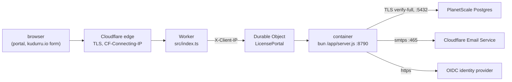

# kudurru license portal on Cloudflare Containers

This directory runs the license portal (`license-server/`) on Cloudflare
Containers behind `https://licenses.kudurru.io`. A Worker receives every
request and hands it to one Durable Object, which runs the portal's image as
its container. The server does all the work (sessions, CSRF, CORS, the API
and the UI); the Worker only redirects plain http, writes the client address,
answers a 503 in the server's error shape when the container cannot answer,
and, from a cron trigger, keeps the container warm and restarts it when a
var or secret changed.

Once enabled, deployment is automatic: after the license portal checks
pass, a change on `main` builds the image, pushes it to Cloudflare, applies
pending Postgres migrations and deploys the Worker with its secrets. Set
up the account, public configuration and GitHub environment once, then set
repository variable `LICENSE_PORTAL_DEPLOY=true`. Until then, the deploy
job is skipped. Subsequent releases need no local Docker commands, manual
migrations or image-tag edits.

**No secret values belong in the repository.** `wrangler.jsonc` contains
infrastructure settings and secret **names**. All non-secret runtime
settings come from GitHub environment variables; credentials come from
GitHub environment secrets. The deploy script supplies both to Cloudflare
without changing the tracked config. Public signing keys
(`internal/license/keys/*.pub`) are safe to commit and must ship with the
image; the corresponding private `.key` stays in your secret manager.

No kudurru node ever contacts the portal. Keys are verified offline on each
node (D163); the portal only issues and delivers them.



| Path | What it is |
|---|---|
| `wrangler.jsonc` | The Worker, container settings, Durable Object, observability, cron trigger and required secret names; the image reference is a placeholder for offline checks |
| `scripts/deploy.ts` | Builds and pushes the image, migrates, generates a temporary image reference and deploys with runtime secrets |
| `../../.github/workflows/license-server.yml` | Checks pull requests and deploys changes on `main`; version tags also publish the signed GHCR image |
| `src/index.ts` | The Worker and the `LicensePortal` Durable Object (a `@cloudflare/containers` `Container`) |
| `src/env.ts` | Which vars and secrets reach the container's environment (checked against the server's `CONFIG_VARS`) |
| `src/http.ts` | The request the container gets, and the Worker's own 503 |
| `local/` | `bun run dev`: the same Worker against a locally built image |
| `test/` | `bun test`: environment forwarding, request handling and deployment secret/configuration checks |

## What it costs

Containers need the Workers Paid plan (5 USD a month). The portal runs on
one `basic` instance (1/4 vCPU, 1 GiB memory). Kept warm by the cron trigger
it costs about 7 USD a month on top of the plan; remove the trigger to let it
sleep after 15 quiet minutes (then a request after a pause waits for a cold
start of a few seconds). Cloudflare Email Service includes 3,000 mails a
month on Workers Paid. PlanetScale is billed through Cloudflare.

## One-time setup

You need the Cloudflare account that holds `kudurru.io` on Workers Paid,
a cloud Postgres database, the signing seed from Infisical and an OIDC
client. GitHub Actions supplies Docker and Bun; you do not need them on
your machine to deploy.

1. **Database.** Use your existing cloud database connection, including its
   current/bootstrap password, as the GitHub secret `DATABASE_URL`. That
   role must be able to create and alter the portal's schema. You do not
   need to create separate roles or run migrations yourself.

   For PlanetScale, use the **direct** port 5432, not PgBouncer on 6432:
   transaction pooling breaks the migration lock and Bun's prepared
   statements. Keep `?sslmode=verify-full` in the URL; weaker TLS modes are
   refused. The database must accept connections from both the CI runner
   and Cloudflare Containers.

2. **Mail.** In the dashboard, onboard `kudurru.io` under Email Service,
   Email Sending. Create an account-owned API token with **Email Sending:
   Edit** permission. Put
   `smtps://api_token:<token>@smtp.mx.cloudflare.net:465` in the GitHub
   secret `SMTP_URL`. The `MAIL_FROM` GitHub variable (or its server
   default) must use an address on the onboarded domain. Another SMTP provider works too.

3. **Identity provider.** Register a confidential client with redirect URI
   `https://licenses.kudurru.io/api/v1/auth/callback`. Customers and staff
   sign in at the same issuer, so it must let customers register (or be
   invited) and verify email addresses itself (`license-server/README.md`,
   "Who signs in"). Set `OIDC_ISSUER` and `OIDC_CLIENT_ID` as GitHub
   environment variables (step 5), and its client secret as
   `OIDC_CLIENT_SECRET`.

4. **Public configuration.** Set runtime settings as GitHub variables
   in step 5. This includes role mappings and
   `LICENSE_SIGNING_TRUSTED_SINCE` (the first kudurru release that embeds
   the signing kid). The custom-domain route for `licenses.kudurru.io` is
   enabled in `wrangler.jsonc`. Leave the placeholder `image` alone: the
   deploy script fills it in without modifying the tracked file.
   The script refuses to deploy while the route does not match
   `PUBLIC_URL`, a required setting is missing, or an `example.org`
   placeholder remains in the resolved deployment variables.

   `ADMIN_NOTIFY_EMAIL` decides who receives each personal-key request
   and its one-click approval link. It is unset by default, so mail goes to
   every enabled license admin and superadmin with a verified email. Set
   the GitHub variable to a comma list of mailboxes only license admins
   read to override those recipients. Any signed-in license admin can
   also decide requests on the Requests page. `PERSONAL_AUTO_APPROVE=false`
   remains the default. See `license-server/README.md`, "Approving personal
   keys", for attribution and quotas when approving by mail.

5. **GitHub environment.** In the repository's Settings → Environments,
   create `license-portal-production`. Allow deployments from `main`.
   Leave required reviewers unset for automatic deployment; add a reviewer
   only if you want an approval gate.

   Add these **environment variables**:

   | Name | Value |
   |---|---|
   | `CLOUDFLARE_ACCOUNT_ID` | Required: the account ID from the Cloudflare dashboard (not a zone ID) |
   | `PUBLIC_URL` | Required: `https://licenses.kudurru.io`, matching the custom-domain route |
   | `OIDC_ISSUER` | Required: the production OIDC issuer URL, exactly as the identity provider writes it (https) |
   | `OIDC_CLIENT_ID` | Required: the confidential OIDC client's ID registered in step 3 |
   | `LICENSE_SIGNING_KID` | Required: `kudurru-2026-1`, or the kid of the committed public key matching `LICENSE_SIGNING_KEY` |
   | `CLIENT_IP_HEADER` | Set to `X-Client-IP`, the header the Worker sets from `CF-Connecting-IP` |
   | `DATABASE_TLS` | Optional: `verify-full` (the server default) |
   | `MIGRATE_ON_START` | Optional: `false` (the deploy script's default and only supported value; CI migrates separately) |
   | `PUBLIC_FORM_ORIGINS` | Optional: `https://kudurru.io` (the server default) |
   | `MAIL_FROM` | Optional: `kudurru license portal <licenses@kudurru.io>` (the server default); must use an onboarded domain |
   | `ADMIN_NOTIFY_EMAIL` | Optional: comma-separated approval mailboxes; leave unset to email verified license admins and superadmins |

   Every other non-secret setting forwarded by `src/env.ts` can also be a
   GitHub variable with its server setting name, including `LOG_LEVEL`,
   `OIDC_SCOPES`, role mappings, signing metadata, session limits and
   quotas. See `license-server/README.md`, "Configuration", for the full
   list and defaults. Empty optional values are omitted so the server's
   defaults apply. Secrets and unrelated GitHub variables are excluded
   from the generated Worker `vars`.

   The workflow passes `${{ toJSON(vars) }}` as `LICENSE_PORTAL_VARIABLES`;
   the deploy script copies only known non-secret portal settings into a
   temporary config. It does not modify `wrangler.jsonc`.

   Add these **environment secrets**, never to `wrangler.jsonc`:

   | Name | Value |
   |---|---|
   | `CLOUDFLARE_API_TOKEN` | A Cloudflare deployment token for this account and zone, allowed to deploy Workers and Containers, push to the managed container registry, and manage the Worker's custom domain |
   | `DATABASE_URL` | Your direct cloud Postgres URL, including the existing password and `?sslmode=verify-full` |
   | `OIDC_CLIENT_SECRET` | The identity provider's client secret |
   | `LICENSE_SIGNING_KEY` | The real licensegen seed from Infisical: standard base64 of 32 bytes, matching `LICENSE_SIGNING_KID` and its committed `.pub` |
   | `SMTP_URL` | The SMTP URL from step 2, including its token/password |

   For the deployment token, start with Cloudflare's **Edit Cloudflare
   Workers** API token template and add **Account → Containers → Edit**
   for this account. Keep the Workers and zone permissions needed to
   deploy the custom domain, scoped to `kudurru.io`. The SMTP token is
   separate and needs only Email Sending permission. See
   [Cloudflare's token permissions](https://developers.cloudflare.com/fundamentals/api/reference/permissions/).

   If you already configured the Worker with `wrangler secret put`, copy
   those same values into the GitHub environment: CI is now their source.
   The deployment token is used only by CI; it never reaches the portal.
   Cloudflare receives runtime secrets through Wrangler's `--secrets-file`
   in the same Worker deployment, including the very first deployment.
   The temporary file has mode `0600`, lives under gitignored `.wrangler/`
   and is deleted even if a deployment command fails. Secrets never enter
   Docker build arguments or the image.

6. **Enable and deploy.** After the environment and public configuration
   are ready, add **repository variable** `LICENSE_PORTAL_DEPLOY` with the
   value `true` under Settings → Secrets and variables → Actions → Variables.
   It must be a repository variable, since the job's condition is evaluated
   before environment variables are available. The workflow can safely land
   before setup: the deploy job is skipped while this variable is absent or
   has any other value.

   Merge the public configuration to `main`, or run **Actions →
   license-server → Run workflow** on `main` after configuring the variable.
   The existing checks must pass first. The first deploy creates the custom
   domain's DNS record and certificate; remove any conflicting DNS record
   beforehand. Check `https://licenses.kudurru.io`.

7. **The first superadmin.** Prefer mapping your identity provider's admin
   group with `ROLE_SUPERADMIN_GROUPS`; members get the role when they sign
   in, with no database command. If your provider has no group mapping,
   sign in once and use the existing one-time `grant-superadmin` command
   from `license-server/README.md`. It is also the recovery path when the
   last superadmin is gone. The portal uses OIDC sign-in, not a separate
   bootstrap login password.

### Optional: separate database roles

When you want narrower runtime permissions, create `license_portal_owner`
and `license_portal_app` with `license-server/deploy/postgres-roles.sql`,
following `license-server/README.md`, "Database roles". On an already
migrated database, transfer ownership of the portal's schema objects to
`license_portal_owner` and apply the grants shown in the SQL file (past
migrations are not rerun). Set the owner's connection as GitHub secret
`DATABASE_MIGRATE_URL`, and change `DATABASE_URL` to the app connection.
The deployment uses the optional owner URL only for migrations; it never
uploads it to Cloudflare or passes it into the serving container.

Until then, omitting `DATABASE_MIGRATE_URL` uses `DATABASE_URL` for both
migrations and serving. The existing/bootstrap database password works;
using it means the serving container also has that role's schema privileges.

## Releasing

A change affecting the license portal on `main` runs the existing checks.
With repository variable `LICENSE_PORTAL_DEPLOY=true`, the `deploy` job in
`.github/workflows/license-server.yml` first checks that the run's commit is
still the current tip of `main`, using the GitHub API and the job's read-only
GitHub token (including for a private repository). A stale queued run or
retry fails before any build, migration or deployment; run the workflow for
the latest commit instead. Then it:

1. Build `license-server/Dockerfile` for `linux/amd64`, the architecture
   Cloudflare runs, with the commit and build metadata.
2. Push the image to the account's managed Cloudflare registry, with a
   unique commit/run/attempt tag. A retry also gets a new tag so a deploy
   starts a rollout.
3. Run the **new image's** `migrate` command against the cloud database,
   using `DATABASE_MIGRATE_URL` when supplied, otherwise `DATABASE_URL`.
   The migration runner locks the database and applies only pending
   migrations. A failure stops the release before the Worker is deployed.
4. Generate a temporary Wrangler config with that image reference and
   deploy the Worker, container and runtime secrets together.
5. Retry `/readyz` while provisioning completes, checking the database,
   schema and signing key. This checks readiness at the public route;
   it does not prove every instance has completed its rollout.

Production deployments are serialized and never canceled midway by a
newer run. Pull requests and non-`main` manual runs have no production
deployment. `license-server-v<version>` tags still publish and sign the
multi-architecture GHCR image; they do not cause a second Cloudflare deploy.

Pasted secrets have surrounding whitespace removed before use. Build and
Git commands receive no portal or Cloudflare credentials; Wrangler receives
only Cloudflare deployment credentials plus its temporary runtime secrets
file. The migration command receives only its database credential.

The image is built explicitly because Wrangler pipes Dockerfiles to
`docker build -f -`, bypassing `license-server/Dockerfile.dockerignore`.
That allowlist keeps secrets out of the build context; the root
`.dockerignore` excludes `license-server/`. CI handles this detail, so
there are no manual image pushes or edits to `wrangler.jsonc` per release.

Cloudflare still needs the Worker and Durable Object to route requests to
one container; Postgres remains your managed cloud database. Migrations
are the portal's schema updates, separate from Cloudflare's Durable Object
storage configuration. The docs site uses Cloudflare Workers Builds to
deploy from GitHub, while its GitHub Actions workflow only checks it.
[Workers Builds also supports Containers](https://developers.cloudflare.com/containers/guides/deploy/#deploy-with-workers-builds);
this workflow keeps the existing checks, Docker allowlist and database
migration step in one release pipeline.

The rollout replaces the one instance in one step. The server drains for
up to 20 seconds on SIGTERM; requests during replacement may receive the
Worker's 503 with `Retry-After`. Migrations must stay compatible with the
previous release while it drains. The server refuses to start against a
schema newer than it knows, so fix forward rather than rolling back across
a migration. If the image upload succeeds but migration or deployment
fails, the pushed image remains in the registry and CI reports failure;
rerun the workflow after fixing the cause.

For a local release, install the pinned Bun version and Docker, export the
same variables/secrets into your shell (including `PUBLIC_URL`,
`OIDC_ISSUER`, `OIDC_CLIENT_ID`, `LICENSE_SIGNING_KID` and
`CLIENT_IP_HEADER`), then run:

```sh
cd license-server/cloudflare
bun install --frozen-lockfile
bun run deploy
```

## Changing configuration

Change a runtime variable or secret in the GitHub environment, then run
**Actions → license-server → Run workflow** on `main`. Changing a GitHub
variable or secret alone does not trigger a workflow. Commit changes to
infrastructure settings in `wrangler.jsonc`; the normal `main` workflow
deploys them.

A running process keeps its startup environment. After the Worker deploys,
the next cron tick (within 5 minutes) notices changed vars or secrets and
restarts the container. Direct dashboard or `wrangler secret put` changes
are replaced by the values from GitHub on the next CI deployment.

## Logs and checks

`observability` explicitly enables Worker/Durable Object logs, invocation
logs and traces, plus container stdout/stderr (the server's JSON lines)
in the Cloudflare dashboard. Request URL query strings are redacted so
approval and invitation tokens are not recorded. `bunx wrangler tail`
follows the Worker. `GET /readyz` reports the database, migrations
and signing (`"signing":"ready"` once the key loaded).

`bun run check` type-checks the Worker, runs the tests and does `wrangler
deploy --dry-run` (no Docker, no login). `bun run dev` runs the Worker and
the locally built image (`make license-server-image`) with `wrangler dev`;
it needs Docker Desktop, Colima or another host where Cloudflare's local
proxy sidecar works (on Linux kernel 6.18 it fails,
cloudflare/containers#231). Develop the portal itself with
`license-server/compose.yaml`.

### A successful email POST with no email received

`POST /api/v1/licenses/:id/email` waits for SMTP submission before returning
200. Worker and Durable Object invocation logs can show the same POST
twice; matching Ray IDs and trace IDs identify one request. These HTTP logs
do not confirm inbox delivery.

The container's `mail configured` startup log includes
`confirmsWithProviderId`. This is `true` for the documented Cloudflare
SMTP hostname, `smtp.mx.cloudflare.net`, and `false` for other hosts.
Use that hostname directly for Cloudflare SMTP; a proxy or CNAME alias
is not automatically identified as Cloudflare and does not enable the
provider receipt check.

Check the effective sender in the container's `mail configured` startup
log (`from`) or the portal's System page. The setting is `MAIL_FROM`;
`EMAIL_FROM` is ignored and leaves the default `licenses@kudurru.io`
sender in place. To send from a subdomain, use a full address, for example
`MAIL_FROM=kudurru license portal <licenses@licensing.kudurru.io>`, and
onboard `licensing.kudurru.io` separately for Cloudflare Email Sending
under the account used by the SMTP token. Onboarding `kudurru.io` alone
does not enable its subdomains. Set the GitHub environment variable and
redeploy as described above. A sender-domain rejection normally causes
SMTP to fail and the email endpoint to return 503.

In the container's JSON logs, find `mail accepted by SMTP` for the request
and license. It includes `requestId`, `licenseId`, `keyId`, the recipient
domain, the local `messageId` and Cloudflare's `providerMessageId`. Search
the provider ID in **Email Service → Email Sending → Activity log** to
check delivery, rejection or a bounce. Message bodies, keys, credentials
and full recipient addresses are not included in the receipt log.

Cloudflare can return `250 2.0.0 Ok` without a Message-ID when **Drop
suppressed recipients** is enabled and the recipient is suppressed. The
portal treats that as an unconfirmed submission, logs `mail submission
not confirmed: Cloudflare returned no Message-ID` and answers 503 for
"Email key" without an emailed audit event. Check account and domain
suppression lists and the sending domain's setting; disabling **Drop
suppressed recipients** makes SMTP reject suppressed sends explicitly.
Only remove a suppression once its underlying reason has been addressed.
See [Cloudflare SMTP submission and suppressions](https://developers.cloudflare.com/email-service/api/send-emails/smtp/#suppressed-recipients).

## Check on the first real deploy

These could not be verified without an account:

1. The headers the container sees (Cookie, Origin, Sec-Fetch-Site, the
   X-Client-IP the Worker writes): sign in, then look at an audit event's IP.
2. Outbound connections to PlanetScale on 5432 and to SMTP on 465.
3. That `max_instances: 2` gives a rollout room for the replacement.
4. That zone security features (Bot Fight Mode, WAF rules) do not challenge
   the cross-origin POST from the kudurru.io form.
5. Memory and CPU headroom on `basic`.
