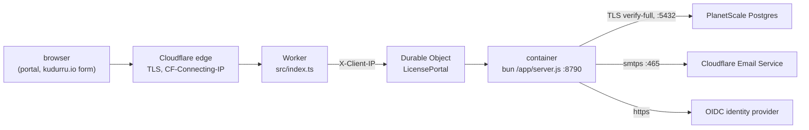

# kudurru license portal on Cloudflare Containers

This directory runs the license portal (`license-server/`) on Cloudflare
Containers behind `https://licenses.kudurru.io`. A Worker receives every
request and hands it to one Durable Object, which runs the portal's image as
its container. The server does all the work (sessions, CSRF, CORS, the API
and the UI); the Worker only redirects plain http, writes the client address,
answers a 503 in the server's error shape when the container cannot answer,
and, from a cron trigger, keeps the container warm and restarts it when a
var or secret changed.

No kudurru node ever contacts the portal. Keys are verified offline on each
node (D156); the portal only issues and delivers them.



| Path | What it is |
|---|---|
| `wrangler.jsonc` | The Worker, the container (image, instance type, rollout), the Durable Object, vars, the cron trigger and the list of required secrets |
| `src/index.ts` | The Worker and the `LicensePortal` Durable Object (a `@cloudflare/containers` `Container`) |
| `src/env.ts` | Which vars and secrets reach the container's environment (checked against the server's `CONFIG_VARS`) |
| `src/http.ts` | The request the container gets, and the Worker's own 503 |
| `local/` | `bun run dev`: the same Worker against a locally built image |
| `test/` | `bun test`: the env list and the request handling |

## What it costs

Containers need the Workers Paid plan (5 USD a month). The portal runs on
one `basic` instance (1/4 vCPU, 1 GiB memory). Kept warm by the cron trigger
it costs about 7 USD a month on top of the plan; remove the trigger to let it
sleep after 15 quiet minutes (then a request after a pause waits for a cold
start of a few seconds). Cloudflare Email Service includes 3,000 mails a
month on Workers Paid. PlanetScale is billed through Cloudflare.

## One-time setup

You need: the Cloudflare account that holds the `kudurru.io` zone, Docker,
Bun, the signing key from Infisical, a PlanetScale Postgres database and an
OIDC client at your identity provider.

1. **Database roles.** Connect to PlanetScale as its default `postgres`
   role on the **direct** port 5432 and create the two roles of the
   least-privilege setup (`license_portal_owner` owns the schema and only
   migrates; `license_portal_app` is all the container holds):

   ```sh
   psql "postgres://postgres:<password>@<host>:5432/<database>?sslmode=verify-full" \
     -v db=<database> -v owner_password='<long random>' -v app_password='<other long random>' \
     -f license-server/deploy/postgres-roles.sql
   ```

   Use port 5432, not PlanetScale's PgBouncer on 6432: its transaction
   pooling breaks the migration lock and Bun's prepared statements, and the
   portal needs at most 10 connections. `?sslmode=verify-full` may stay in
   the URLs; anything weaker is refused.

2. **Migrate** as the owner, from your machine or CI. It needs only the
   database settings:

   ```sh
   docker run --rm \
     -e DATABASE_MIGRATE_URL='postgres://license_portal_owner:<password>@<host>:5432/<database>?sslmode=verify-full' \
     ghcr.io/robertherbaugh/kudurru-license-server:<version> migrate
   ```

   Migration 0002 grants `license_portal_app` exactly what the server's SQL
   uses (`license-server/README.md`, "Database roles").

3. **Mail.** In the dashboard, onboard `kudurru.io` under Email Service,
   Email Sending. Create an account-owned API token with the **Email Sending:
   Edit** permission. The SMTP URL is
   `smtps://api_token:<token>@smtp.mx.cloudflare.net:465` (implicit TLS on
   465 is the only port Cloudflare accepts). `MAIL_FROM` in `wrangler.jsonc`
   must be an address on the onboarded domain.

4. **Identity provider.** Register a confidential client with the redirect
   URI `https://licenses.kudurru.io/api/v1/auth/callback`. Customers and
   staff sign in at the same issuer, so it must let customers register (or
   be invited) and must verify email addresses itself
   (`license-server/README.md`, "Who signs in").

5. **Vars.** Edit `wrangler.jsonc`: `OIDC_ISSUER`, `OIDC_CLIENT_ID`, the
   role mappings and `OIDC_ADMIN_CLAIM_RULES` if you map admin groups,
   `LICENSE_SIGNING_TRUSTED_SINCE` (the first kudurru release that embeds
   the signing kid), and uncomment the `routes` entry for
   `licenses.kudurru.io`.

6. **Secrets.** Each once (the deploy fails while a required one is missing):

   ```sh
   cd license-server/cloudflare && bun install --frozen-lockfile
   bunx wrangler secret put DATABASE_URL          # postgres://license_portal_app:…@<host>:5432/<db>?sslmode=verify-full
   bunx wrangler secret put OIDC_CLIENT_SECRET
   bunx wrangler secret put LICENSE_SIGNING_KEY   # the licensegen seed, e.g. from Infisical LICENSE_SIGNING_KEY
   bunx wrangler secret put SMTP_URL              # smtps://api_token:<token>@smtp.mx.cloudflare.net:465
   ```

   Cloudflare passes secrets to a container only as environment variables,
   which is why the server accepts `LICENSE_SIGNING_KEY` (elsewhere prefer
   `LICENSE_SIGNING_KEY_FILE`). The container has no SSH and the image no
   shell.

7. **Image and deploy.** See "Releasing" below for the first release.

8. **The first superadmin.** Sign in to the portal once, then grant
   yourself the role from your machine (database settings only; the
   runtime role is enough):

   ```sh
   docker run --rm \
     -e DATABASE_URL='postgres://license_portal_app:<password>@<host>:5432/<database>?sslmode=verify-full' \
     ghcr.io/robertherbaugh/kudurru-license-server:<version> grant-superadmin --email you@kudurru.io
   ```

   It also recovers access when the last superadmin is gone.

## Releasing

Wrangler builds images by piping a Dockerfile to `docker build -f -`, which
cannot build `license-server/Dockerfile` (BuildKit then ignores its
allowlist, `Dockerfile.dockerignore`, and reads the repository's
`.dockerignore`, which excludes `license-server/`). So the image is built as
usual and pushed to your account's registry:

```sh
# 1. Migrate first (step 2 above): migrations stay compatible with the previous release.
# 2. Build for linux/amd64 (Cloudflare runs nothing else) and push.
docker build --platform linux/amd64 -f license-server/Dockerfile \
  --build-arg VERSION=<version> --build-arg COMMIT=$(git rev-parse --short HEAD) \
  -t kudurru-license-server:<version> .
cd license-server/cloudflare && bunx wrangler containers push kudurru-license-server:<version>
# 3. Put the printed registry.cloudflare.com/<account>/kudurru-license-server:<version>
#    into "image" in wrangler.jsonc, then deploy.
bun run deploy
```

Use a new tag for every release: a deploy with an unchanged image starts no
rollout. The rollout replaces the one instance in one step; the server
drains for up to 20 seconds on SIGTERM and requests in that window get the
Worker's 503 with `Retry-After`. The server refuses to start against a
schema newer than it knows, so fix forward rather than rolling back across a
migration.

## Changing configuration

A running process keeps the environment it started with. After `wrangler
secret put` or a change to `vars` (and `bun run deploy`), the next cron tick
(within 5 minutes) notices the changed environment and restarts the
container.

## Logs and checks

`observability` is on: Worker, Durable Object and container logs (the
server's JSON lines) are in the dashboard for 7 days, and `bunx wrangler
tail` follows the Worker. `GET /readyz` reports the database, migrations
and signing (`"signing":"ready"` once the key loaded).

`bun run check` type-checks the Worker, runs the tests and does `wrangler
deploy --dry-run` (no Docker, no login). `bun run dev` runs the Worker and
the locally built image (`make license-server-image`) with `wrangler dev`;
it needs Docker Desktop, Colima or another host where Cloudflare's local
proxy sidecar works (on Linux kernel 6.18 it fails,
cloudflare/containers#231). Develop the portal itself with
`license-server/compose.yaml`.

## Check on the first real deploy

These could not be verified without an account:

1. The headers the container sees (Cookie, Origin, Sec-Fetch-Site, the
   X-Client-IP the Worker writes): sign in, then look at an audit event's IP.
2. Outbound connections to PlanetScale on 5432 and to SMTP on 465.
3. That `max_instances: 2` gives a rollout room for the replacement.
4. That zone security features (Bot Fight Mode, WAF rules) do not challenge
   the cross-origin POST from the kudurru.io form.
5. Memory and CPU headroom on `basic`.
