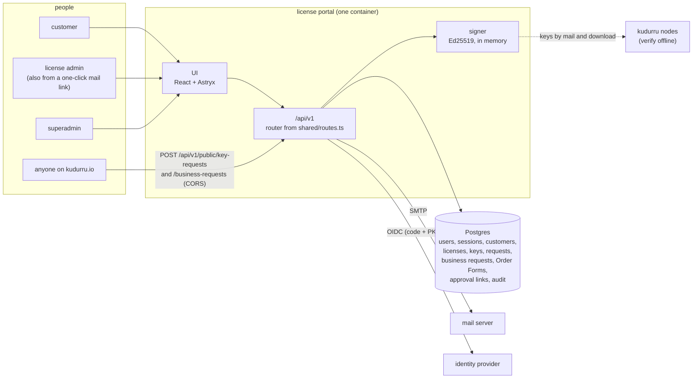
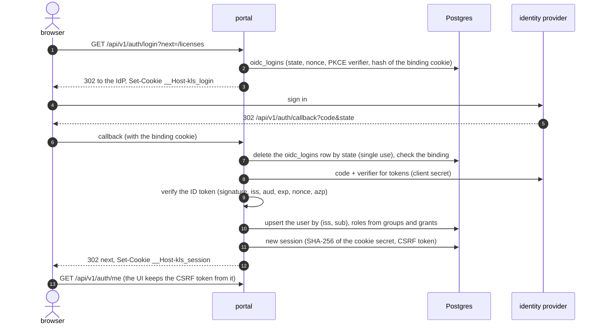
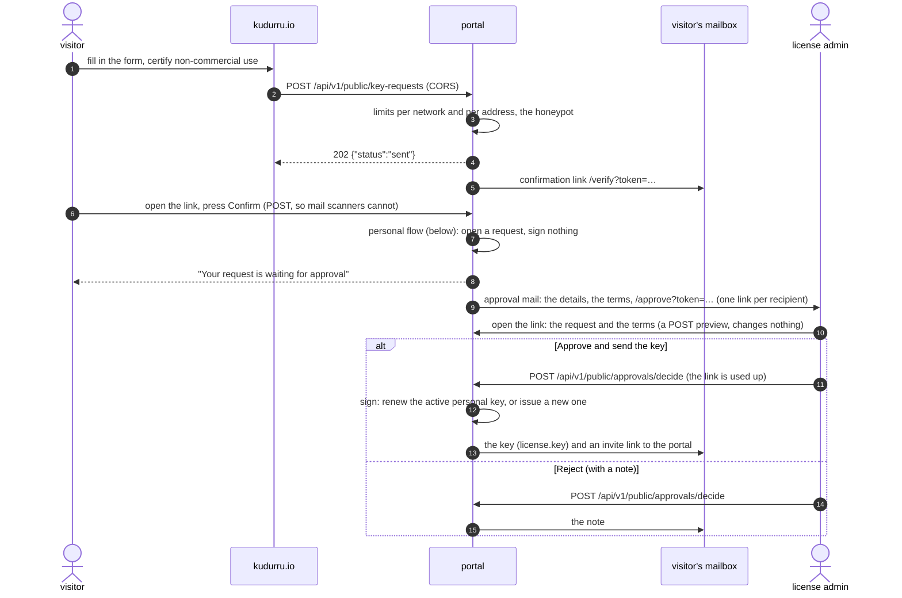
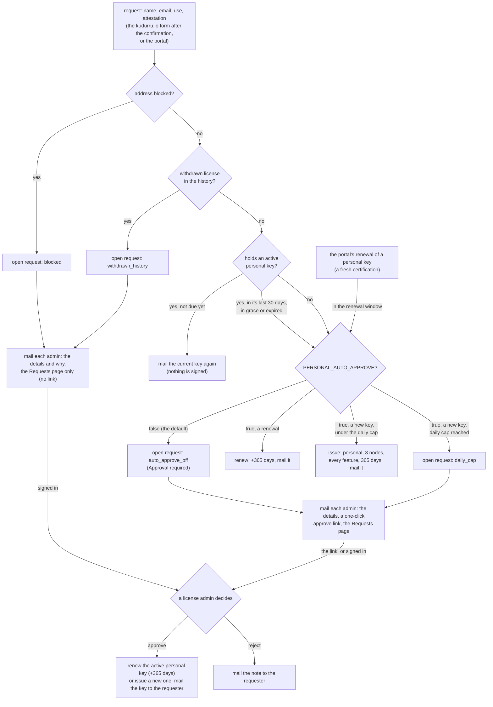
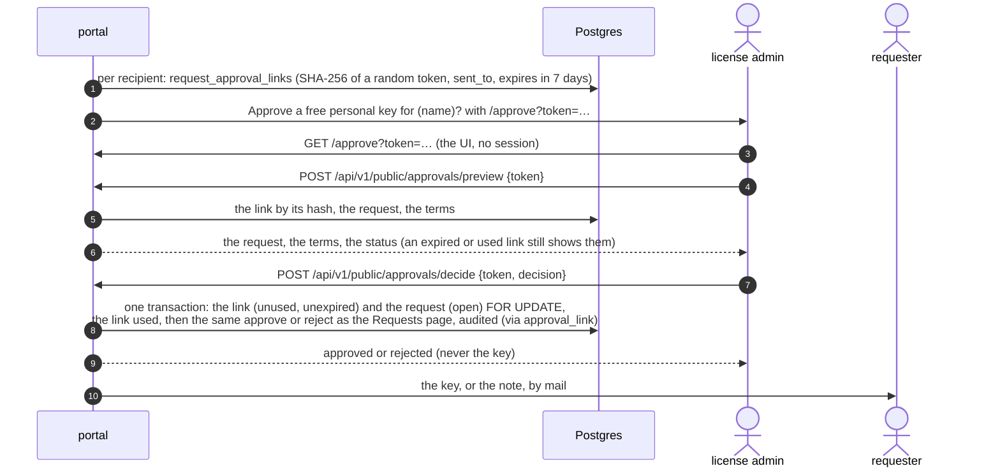
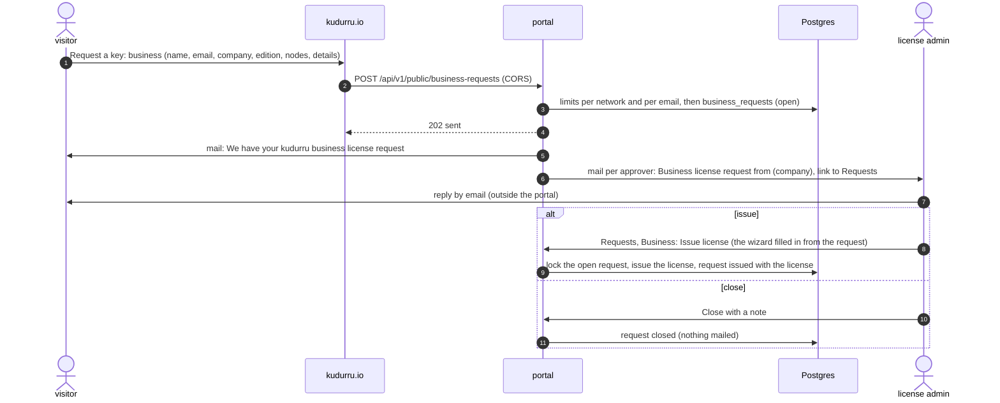
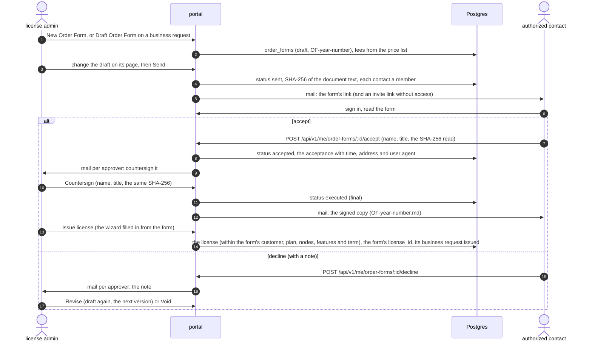
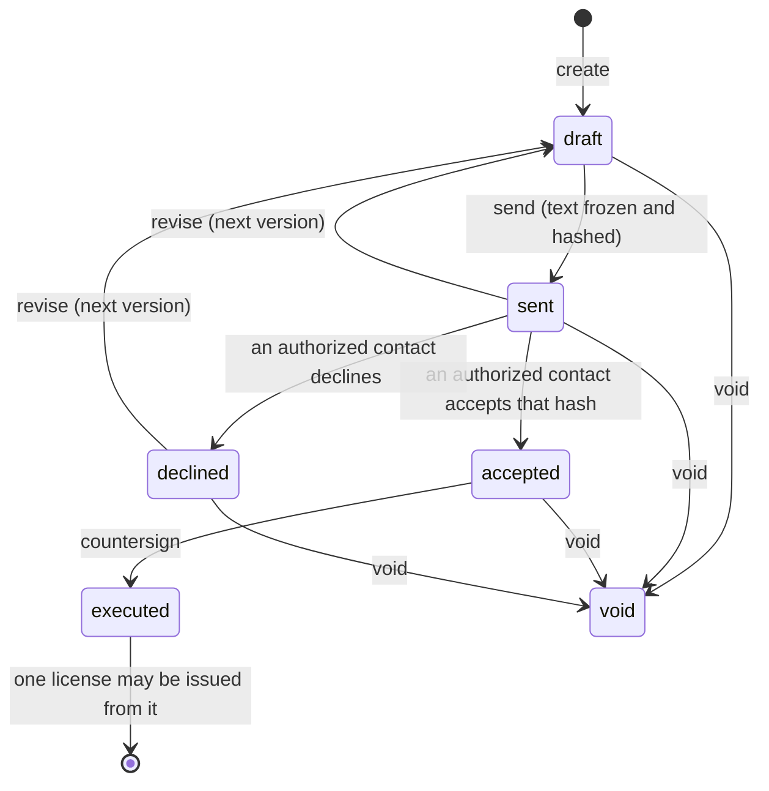
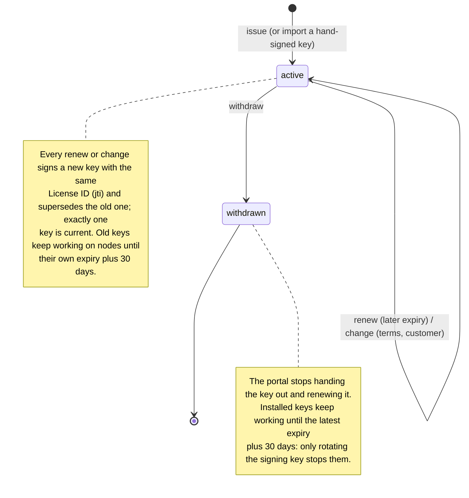
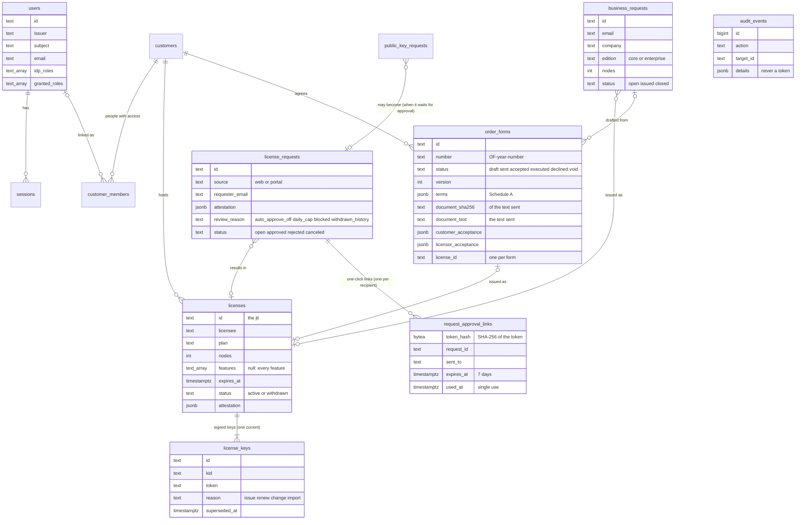

# How the license portal works

The license portal issues kudurru license keys and hands them to the people
they belong to. It never talks to a kudurru node, and no node ever talks to
it: a node checks a key's signature offline against the public keys built
into its binary (`docs/architecture/licensing.md`, D163). Operating detail
is in [../README.md](../README.md); this page shows the flows.

Code: `server/` (Bun), `ui/` (React, Astryx), `shared/` (what both use),
`cloudflare/` (the Worker in front of the container on Cloudflare).

## Components

The signing key comes from a secret at run time (a file, or an environment
variable on Cloudflare) and stays in memory. Postgres holds the record:
who holds which license, every key signed, the attestations and the
append-only audit trail.

## Sign-in

A failure ends at `/login?error=<key>` with a fixed sentence; the cause is
only logged.

## A personal key from the kudurru.io form

The personal flow is shared with the portal's own "Request a free personal
key" and its renewal ("Request renewal", or "Renew" with
`PERSONAL_AUTO_APPROVE=true`). With `PERSONAL_AUTO_APPROVE=false`, the
default, it signs nothing: every new key and every renewal becomes a
request that a license admin approves.

A request while one is already open for the address is that request: no
second request and no second mail. The admins are the addresses in
`ADMIN_NOTIFY_EMAIL`, or, when it is unset, every enabled license admin and
superadmin with a verified email.

### The one-click link

Opening the link never decides (mail scanners open links): the decision is
a POST from the page. The token is 32 random bytes, mailed once and stored
only as its SHA-256; it works for 7 days and once, and a request decided
any other way (on the Requests page, or through another recipient's link)
makes every link to it useless. A link also stops deciding when its
address no longer approves (it left `ADMIN_NOTIFY_EMAIL`, or its admin was
disabled or lost the role). The actor is the one enabled license admin or
superadmin whose verified email the link went to, and the approval counts
against their `ISSUE_MAX_PER_ACTOR_PER_DAY`; else it is the system actor
`approval link (<address>)`, which has no issuing quota. Both routes are
rate limited per client address. The preview answers for a used or expired
link too, until the cleanup deletes the link 30 days after its expiry.

## A business request from the kudurru.io form

There is no confirmation link: nothing is signed until a license admin
issues a license, so the request is stored at once. When the portal cannot
be reached or cannot take it, the form opens an email to hello@kudurru.io
with the same fields instead.

## An Order Form

The text a party accepts is `orderFormDocument` without signatures
(`shared/orderForms.ts`), stored when the form is sent; every kept copy
is that stored text with the acceptances appended. Both acceptances record
its SHA-256, and the
accept and countersign bodies name the hash the person saw, so an answer
to a revised form's earlier text is refused (409). Only a signed-in member
of the customer whose membership address is one of the form's authorized
contacts answers it; other members see it. Customers never see drafts,
void reasons or who did what in the back office.

## A license's keys

What the server state shows follows the node: active until `exp`,
"expires soon" in the last 30 days, "in grace" for 30 days after `exp`,
then expired. `exp` is 23:59:59 UTC of the chosen day, so the portal and
`kudurru license status` print the same date.

## Data model

`audit_events` refuses UPDATE, DELETE and TRUNCATE by trigger, and the
runtime role may only read and append it (migration 0002). The cleanup
job deletes approval links 30 days after they expire (migration 0003 adds
the table and its grant). Deleting a user (migration 0004 grants it)
deletes their sessions and memberships; every other reference keeps its
label and loses the link. Migration 0005 adds `business_requests`, 0006
`order_forms` and its number sequence (forms are never deleted).

## Roles

| Permission | customer | license admin | superadmin |
|---|---|---|---|
| Own licenses and keys (members of a customer), personal key requests, asking for the renewal of a personal key, accepting invites, the Order Forms of member customers (accepting and declining them as an authorized contact) | yes | yes | yes |
| Customers, members, licenses (issue, import, renew, change, withdraw, email), Order Forms (draft, change, send, revise, countersign, void), requests (approve, reject; business requests: issue, close), the block list, users (read), audit, system | | yes | yes |
| Granting roles, disabling and deleting users, ending sessions, removing block list entries | | | yes |

`shared/permissions.ts` is the source; every route in `shared/routes.ts`
names the one permission it needs, and `server/test/rbac.test.ts` checks
each route against each role. The one-click approval routes are anonymous:
the token in the link is the credential, not a role.
