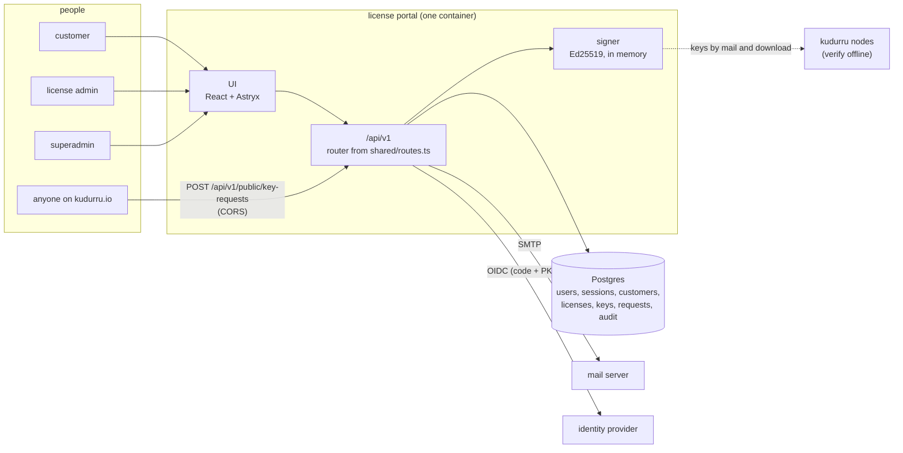
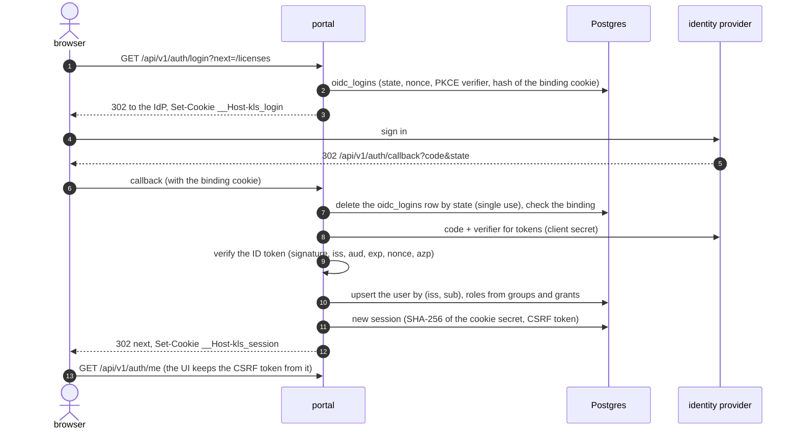
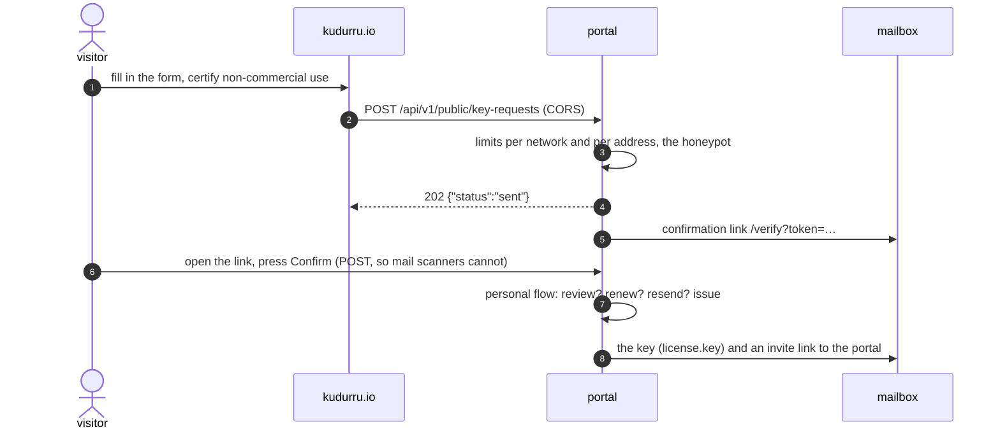
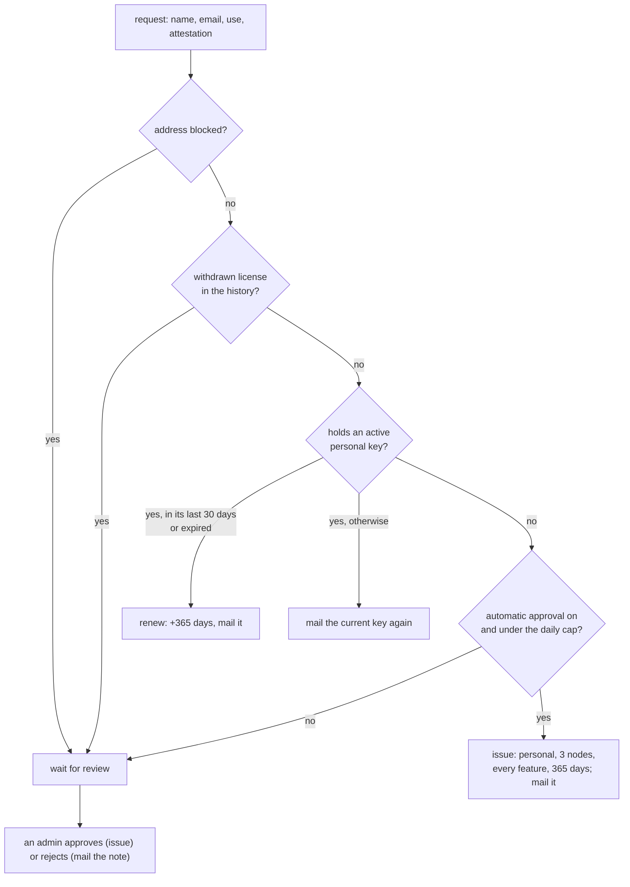
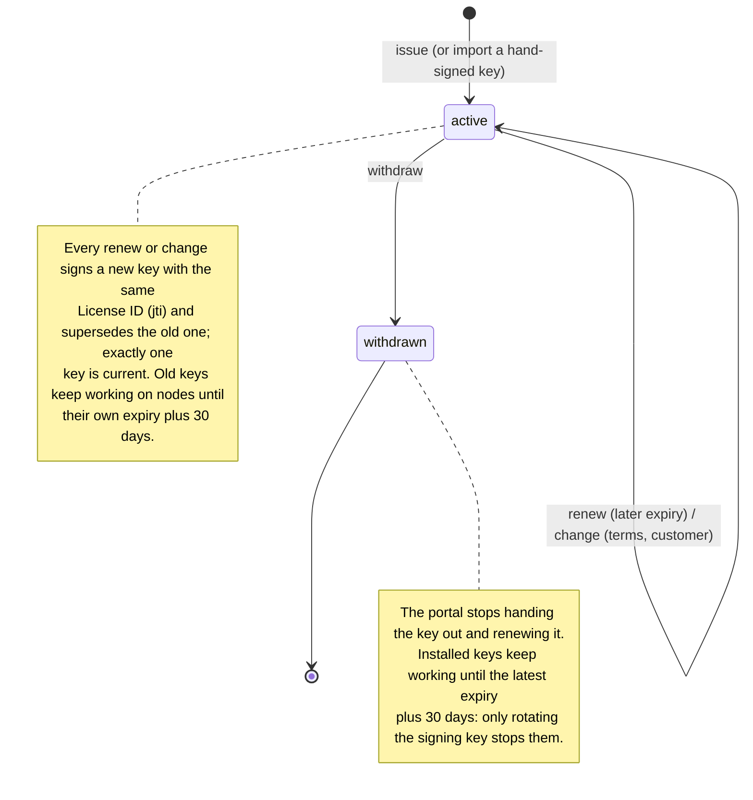
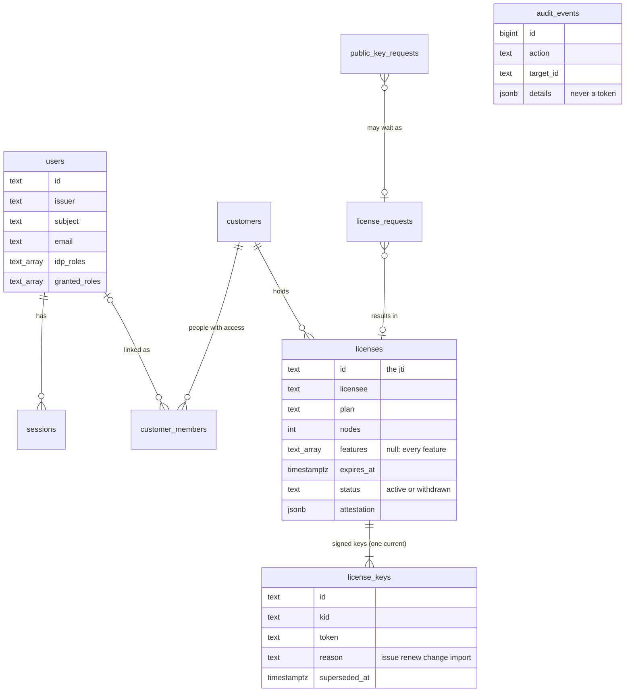

# How the license portal works

The license portal issues kudurru license keys and hands them to the people
they belong to. It never talks to a kudurru node, and no node ever talks to
it: a node checks a key's signature offline against the public keys built
into its binary (`docs/architecture/licensing.md`, D163). Operating detail
is in [../README.md](../README.md); this page shows the flows.

Code: `server/` (Bun), `ui/` (React, Astryx), `shared/` (what both use),
`cloudflare/` (the Worker in front of the container on Cloudflare).

## Components

The signing key comes from a secret at run time (a file, or an environment
variable on Cloudflare) and stays in memory. Postgres holds the record:
who holds which license, every key signed, the attestations and the
append-only audit trail.

## Sign-in

A failure ends at `/login?error=<key>` with a fixed sentence; the cause is
only logged.

## A personal key from the kudurru.io form

The personal flow is shared with the portal's own "Request a free personal
key":

## A license's keys

What the server state shows follows the node: active until `exp`,
"expires soon" in the last 30 days, "in grace" for 30 days after `exp`,
then expired. `exp` is 23:59:59 UTC of the chosen day, so the portal and
`kudurru license status` print the same date.

## Data model

`audit_events` refuses UPDATE, DELETE and TRUNCATE by trigger, and the
runtime role may only read and append it (migration 0002).

## Roles

| Permission | customer | license admin | superadmin |
|---|---|---|---|
| Own licenses and keys (members of a customer), personal key requests, renewing a personal key, accepting invites | yes | yes | yes |
| Customers, members, licenses (issue, import, renew, change, withdraw, email), requests, the block list, users (read), audit, system | | yes | yes |
| Granting roles, disabling users, ending sessions, removing block list entries | | | yes |

`shared/permissions.ts` is the source; every route in `shared/routes.ts`
names the one permission it needs, and `server/test/rbac.test.ts` checks
each route against each role.
